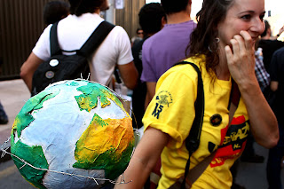
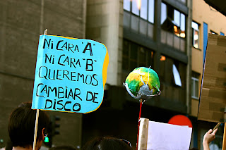
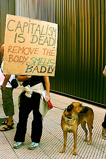
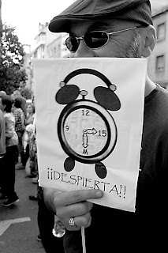
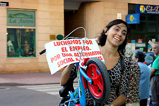
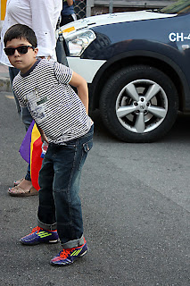
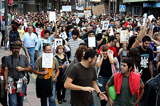
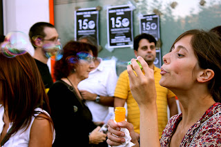
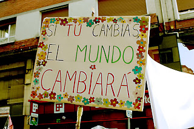
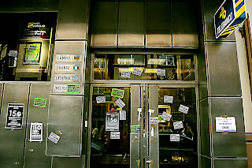

# El cambio global se irradia desde el 15 O: yo lo viví en Mieres

Si todo esto resulta ser una vibración que afecta al medio, es conveniente observarla  en su modo de propagarse.

Desde Túnez se propaga a la ya histórica Plaza Tahrir y salta casi por arte de magia a las ciudades españolas orbitando entorno a Sol, la Puerta. En días, brota en Grecia y orilla por completo el Mediterráneo al prender en las calles de Italia. Día y noche en nuestras rebautizadas plazas nos maravillamos con la singularidad de esas sorprendentes semanas, recibiendo noticias de réplicas de diversa magnitud con epicentros dispersos por toda Europa. Conforme avanzaba el verano, algunos paseaban de Finisterra a Bruselas, preguntándose si en el corazón de esta cosa que dicen que es la Unión Europea se escondía el secreto;  mientras, todos tarde o temprano acabamos por imaginar que más allá del vasto océano hay algo más. Y vaya si lo hubo. Uno de los meollos más destacados de todas esas circunstancias que tanto entorpecen y desagradan, se ve rodeado de fuerzas de seguridad del estado y, entorno a ellos, gente armada con dispositivos de emisión de SMS´s tierra-tierra y sacos de dormir: la “Calle Muro” de Manhattan es ocupada antes de que muera el verano. De modo exponencial, también pasa a ser una más de entre las innumerables ocupaciones que los ciudadanos de Norte América protagonizan en sus propios espacios públicos.

Sobre este vibrante sustrato, amanece un sábado a fecha de 15 de octubre de 2011. Mañaneando, reviso las noticias y me encuentro con que en Australia había amanecido el día antes al ver que la gente australiana y japonesa ha salido ya a sus respectivas calles. Yo, lo viví en Mieres. Y lo cuento con unas fotografías.

  

  

  

  

  

  

  

  

  

Como referencia, cito estas noticias:

[Alrededor de 15.000 indignados participan en la manifestación de Mieres](http://www.rtpa.es/sociedad:Los-indignados-de-todo-el-mundo-%22unidos-por-un-cambio-global%22-_111318670161.html)

[Cerca de 15.000 personas apoyan al Movimiento 15-M en Mieres](http://www.lne.es/asturias/2011/10/15/cerca-15000-personas-apoyan-movimiento-15-m-mieres/1143203.html)  
[Cuenca Minera](http://www.youtube.com/watch?v=x6JZvpKmd6k)

Entonces acabó el 15 y vino el 16. Bueno, cuando acabara en California, o en Hawai. Comprobamos que el objetivo de globalidad se había cumplido, se había abarcado todo el planeta, de Norte a Sur, de Este a Oeste. Y que lo que atraviesa las fronteras por un extremo, lo recibimos de vuelta por el opuesto: los límites geométricos se han alcanzado.

Al deslizar el dedo mojado por el borde de una copa, se producen vibraciones a lo largo del cristal que conviven en su interior, en un medio donde su propagación está confinada. Y al volver las vibraciones, se encuentran con otras que van, conviviendo en un estado estacionario estable de vibración, sumándose unas a otras. Los físicos lo llaman modos de vibración. Y pueden crecer hasta hacer la copa estallar en pedazos. Solo con un simple y mantenido deslizamiento de la punta del dedo. Para quien le sirva, esta metáfora.
