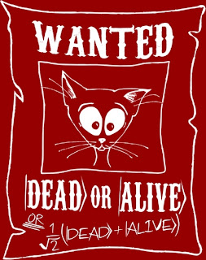
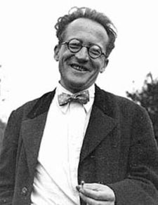
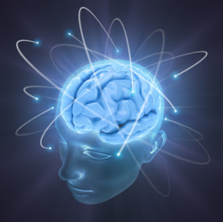

# Gatos de Schröndringer, pensamientos cuánticos e, incluso, petirrojos magnéticos

Toda persona medianamente sana ha de conocer necesariamente un poquito sobre todo eso de la mecánica cuántica. Me refiero a todas esas cosas raras de los electrones y los fotones... La posición habitual frente a ella se consolida sobre dos pilares fundamentales: “eso son historias para científicos locos”, y “qué más me dan a mi los fotones esos”. Sin embargo, muchos científicos locos no tienen vidas tan distintas a las de la mayoría; es más, podrían incluso estar camuflados entre nosotros. Además, los fotones y los asuntos que les atañen podrían no ser tan ajenos a nuestro cotidiano deambular por esta vida tan caprichosa, a veces.

Yendo al grano, Schröndringer resultó ser un austro-húngaro nacido ya muy a finales del siglo 19. Al igual que algunos contemporáneos suyos decidió convertirse en físico loco intentando desentrañar algunos aspectos del comportamiento de las partículas que componen la materia. La disciplina de vanguardia por aquellos tiempos recibió el nombre de mecánica cuántica refiriendo el hecho de que las interacciones entre partículas parecían estar cuantificadas de modo discreto, no continuo: así como un vendedor y un comprador no pueden intercambiar 3 céntimos y medio, las partículas únicamente pueden intercambiar ciertas cantidades de energía en forma de cuantos indivisibles. El mérito más importante de este hombre es el de brindar a la humanidad un concepto y una herramienta de cálculo para relacionar la posición de una partícula con el tiempo: la función de onda. Aun así, ya se sabe, cada solución nos trae de la mano siempre nuevos e inesperados imprevistos. Y resulta que la posición de una partícula nunca puede quedar determinada, si no que se difumina en un estar y no estar simultáneo en cada punto del espacio, del que solo podemos conocer la probabilidad de que al mirar la partícula nos manifieste su presencia o, por el contrario, no encontremos nada en absoluto. Y, por este gran favor, la ciencia le está agradecida...

Hay otra cosa más... Schröndringer dejó un experimento mental. Hay una caja. En la caja hay un átomo radiactivo. También hay una ampolla. Y veneno en su interior. ¿Bien? Pues debajo hay un gato que, si el átomo de desintegra rompe la ampolla, sale el veneno y... bueno, entonces el gato muere. Según las caprichosas leyes, o mejor dicho “no leyes”, de la mecánica cuántica, el núcleo del átomo  se encuentra en un estado superpuesto de dos posibilidades: desintegrarse o no. Todo parecía muy claro hasta tropezar con este detalle. ¿Qué demonios pasa ahora con el gato? ¿Está vivo, muerto o todo a la vez?

La respuesta al dilema, cuando queremos parecer auténticos expertos en asuntos cuánticos, ha de pasar necesariamente por “observar al observador”. Hasta ahora ha sido necesario encerrar todo en una habitación, lejos de cualquier observador que pueda ver, o interactuar con, lo que dentro sucede. Porque antes de que nadie mire dentro, el gato está vivo a la vez que envenenado y solo cuando un observador interactúa se manifiesta una opción frente a la otra, que resultó nunca haber ocurrido. Este proceso aberrante para la inteligencia de quien la pueda tener es quizá la historia más increíble jamás contada. Y se le denomina colapso del vector de estado. A mi modo de ver, y como detallaré más adelante en otras entradas de este blog, este concepto se encuentra en la frontera misma entre ciencia y no ciencia. Como desafío último para el lector audaz, pruebe el experimento encerrando la habitación y al observador A en una caja fuera de la cual se encuentra el observador B.

[El gato en acción](http://www.youtube.com/watch?v=JC9A_E5kg7Y)

El meollo de este experimento mental es el contagio del comportamiento cuántico de las partículas a objetos o sistemas macroscópicos. El aspecto cuántico de sí y no simultáneamente, tan extraño a la experiencia cotidiana se transmite a través de una cadena de sucesos hasta llegar al gato. En cambio, en los experimentos no mentales, en el proceder habitual de las cosas normales, las interrelaciones entre partículas resultan tan complejas y entrelazadas que los comportamientos individuales dan lugar a otros colectivos, compartidos u homogéneos. Este intercambio multitudinario da lugar a estados macroscópicos promediados, pudiendo delimitarse dentro de los rangos de vivo, muerto, aquí o allí... que resultan mucho más familiares. A esta difusión de propiedades exóticas se le denomina decoherencia. La siguiente cuestión que surge en el transcurrir de estas ideas es: ¿existen o son si quiera posibles, sistemas grandes de tan limitada decoherencia que exhiban comportamiento cuántico? Quizá esto decepcione a algunos, pero la respuesta es sí.

El petirrojo europeo es la prueba de ello. Este ave migratoria pasa el verano en Escandinavia y el invierno en el Norte de África. Para tales viajes requiere  un modo de orientación que la evolución natural le ha brindado consistente en la capacidad de percibir la inclinación del campo magnético, la cual aumenta al aproximarse a los polos. Pero hay algo peculiar en este sexto sentido magnético: se ha comprobado que al cegar su visión se inhibe la sensibilidad magnética. El hecho ha sido investigado por un grupo de científicos de la Universidad de Oxford observando moléculas similares a las que existen en la retina de estas aves. En el estudio describen que tales moléculas liberan un par de electrones entrelazados cuánticamente al recibir fotones, haciendo a la sustancia sensible al campo magnético. Las diferentes inclinaciones supondrían ligeros cambios químicos que posteriormente sean convertidos en señales nerviosas características. Sin embargo, solo hay un modo de que esto ocurra. Es preciso que el entrelazamiento del muchos pares de electrones se mantenga por cierto tiempo y a cierta distancia. Al parecer, en la retina se mantiene el entrelazamiento en una situación de baja decoherencia durante al menos 100 microsegundos. Se desconoce cómo es capaz la retina del petirrojo de limitar la decoherencia con el doble de eficiencia que los mejores dispositivos actuales, pero al parecer lo hace sin demasiado esfuerzo.

Voy a forzar un poco más el alcance del gato de Schröndinger, sometiéndola a otra de las mentes inmensas del fructífero siglo 20. No, no es Miguel Gila, si no Roger Penrose, físico y matemático británico. En una de sus obras maestras destinadas a personas humanas y corrientes, “La nueva mente del emperador” comenta algo muy curioso. Si resulta que es el cerebro sensible a estímulos constituidos por un solo fotón, como ya se ha demostrado en experimentos con la retina, y ese fotón, como partícula descrita por la mecánica cuántica, puede haber llegado o no, ¿qué podemos decir de los procesos cerebrales relacionados con la percepción de tan indeciso fotón? Si la partícula es una superposición de “haber llegado” y “no haber llegado”, también las ideas en la mente son una superposición de “haberlo visto” y “no haberlo visto”. Resulta difícil no encontrar contradicción en estos detalles, del mismo modo que resulta difícil no encontrar analogía con otro experimento casi tan mental como el del gato de antes. A fin de cuentas, el cerebro es un sistema muy singular en cuanto al elevado orden que supone su estructura y a la capacidad de realizar conexiones muy definidas extremadamente sensibles a procesos en que participan pocas moléculas. Puede ser un fantástico sistema que limita esos intercambios infructuosos y desordenados que mide la decoherencia. Podría ser el cerebro el mejor experimento “no mental” del gato de Schröndinger, estando tan delante de las narices que resultaría irritante reconocer cuánto se ha tardado en encontrarlo. Sin embargo, el amigo Penrose admite que le seduce la idea de que las ideas puedan comportarse de ese modo tan superpuesto. Quizá no sea tan descabellado entender las ideas en la mente como una mezcla de contradicciones y tendencias en múltiples direcciones que conviven simultáneamente durante unas imperceptibles fracciones de segundo para, súbitamente, desmoronarse en una única y bien definida idea estable. Es un mecanismo tremendamente similar al mencionado colapso del vector estado. Y aquí entra lo último, punto de vista expuesto por el genial pensador con el que, valga decirlo, me encuentro muy cómodo. Colapsar el vector de estado supone ver el sistema, medirlo, interactuar con él: observarlo. Pero, ¿quién puede observar los pensamientos, no son ellos quienes observan? No. No lo son. Es la consciencia. Como ya se comentó, los eruditos en cosas cuánticas, al fin y al cabo, han de pensar siempre en observar al observador...

Más aún:  
  

<http://delightfulobservaciones.blogspot.co.uk/2012/11/mecanica-cuantica-y-recursividad-como_13.html>  
<http://delightfulobservaciones.blogspot.co.uk/2013/01/la-historia-del-universo-en-una-sola.html>  
<http://delightfulobservaciones.blogspot.co.uk/2012/04/el-huevo-la-vez-que-la-gallina.html>  
<http://delightfulobservaciones.blogspot.co.uk/2011/10/sobre-la-consciencia.html>

Sobre lo comentado, literatura gourmette:

Vivir en un mundo cuántico. Vlatko Vedral. Investigación y Ciencia (agosto 2011)

La nueva mente del emperador. Roger Penrose. Oxford University Press 1989.
