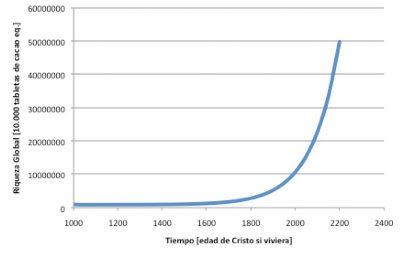

# ¿Soy más rico que Fernando I de Aragón?

Para que os podáis hacer una idea de la riqueza que me desborda, cuando me levanto por la mañana me doy una ducha con agua caliente, tomo un zumo fresquito de frutas traídas de rincones diversos del globo, como el mango o la piña indonesa, un cafetito de la selva amazónica de Brasil y unas pastillas de cacao llegadas a mi desde el lejano Ecuador. Puedo salir de mi cálida casa en un vehículo tirado por el equivalente a 87 caballos y llevar a bordo la música de 200 orquestas sinfónicas. Además, gran parte del tiempo soy instruido por grandes sabios cuyo conocimiento de las ciencias de la Tierra, de la Vida y del Universo resulta abrumador. Si en mi trabajo sintiera calor, instantáneamente podría refrescar el ambiente hasta dejarlo ciertamente agradable. Y un largo etcétera de maravillas que mi riqueza podría abarcar a lo largo de un día cualquiera, hasta terminar en mi cama, más o menos cálida.

¿Cómo sería restregar toda esta vasta riqueza a un auténtico monarca de un imperio, con permiso de su Señora? La envidia y la ira de sentirse inferior que un simple mortal le llevaría a acusarme de judío, o de hijo de mozárabe por parte de madre, o incluso hereje blasfemo (uf, eso sería terrible...). Pero, de todas formas, yo tendría capacidad de disfrutar de cosas que él ni si quiera podría imaginar.

Entonces, ¿qué convierte a Fernando I en rico y a mi en plebeyo de clase media tirando a muy baja? Efectivamente, la clave reside en entender la riqueza en términos relativos. Yo soy pobre porque no tengo más que la mayoría, mientras que nuestro excelso rey Nando, se reconoce como rico por destacar su capacidad de disfrutar de bienes y servicios sobre el grueso de sus súbditos. Del mismo modo, si pensamos en tío Amancio, el que vende género, su capacidad de disfrutar bienes y servicios multiplica en muchimillones de veces la del humano estándar.

Un rico, como todo en esta vida, no persigue nada más determinadamente que perseverar en su naturaleza. Y eso pasa necesariamente por asegurarse de que bajo ningún concepto se mermará su nivel adquisitivo, buscando siempre aumentar la brecha con quienes pretenden equiparase a él. Claro, es su razón de ser: todo lo que existe ha llegado aquí esforzándose tenazmente en no desaparecer. Igual que yo lucho por no vivir como la gente de Somalia, es lógico.

Hasta este punto todo es muy obvio. En términos globales, la riqueza real crece con el desarrollo científico y tecnológico, en el que se incluye cualquier disciplina que trate sobre rendimientos, optimización y gestión de recursos. Y, como éstos,  su evolución resulta exponencial, pues multiplica lo acumulado hasta entonces. Así que a continuación se muestra un sencillo gráfico:

   

Por otro lado, quien diga que poniendo lo de aquí allá y lo de acá ahí se incrementará la riqueza total, como en muchas disciplinas poco tangibles de la economía, cree que hacer malabares con naranjas incrementa el número total de frutas. Globalmente crece, pero su distribución puede evolucionar de múltiples formas.

Observando la evolución de riqueza, que podemos medir en millones de tabletas de cacao equivalentes, se comprende bien que las migajas de un pobrecillo como yo serían el derroche de nuestro querido amigo Nando el Maño cinco siglos antes. Pero, ¿cuántas tabletas ha tenido que acaparar tío Amancio para que yo le considere rico?

Realmente, no sabría determinar la capacidad de los ricos para acaparar la riqueza que el paso del tiempo crea. No se me ocurre un punto de partida para investigar esa cuestión, y dudo que haya muchos manuales accesibles sobre cómo concentrar la riqueza mundial. Además, la ley de crecimiento exponencial es un monstruo. Aun así, tengo fundadas sospechas de que hay personajes y organizaciones cuya capacidad de actuación es difícil de concebir. De hecho, muchos días me encuentro pensando que algo en algún lugar pretende retener todo este progreso por incapacidad de abarcarlo, rechazando todo lo inminentemente inmenso mientras no consiga la seguridad de que lo dominará. [Citando algunos ejemplos de actualidad, este punto de vista ofrece una interesante perspectiva.](https://www.blogger.com/blogger.g?blogID=2477801761344871037) La famosísima Crisis se nos presenta como una deceleración en la creación de riqueza pero,  por qué permitirían las más archipoderosas corporaciones la creación de bienes que no van a ser capaces de adquirir en su totalidad: irían a parar a otros, disminuyendo su riqueza relativa. O por qué tolerarían los bancos gigantes inyecciones de liquidez mientras no se aseguren que nada va a llegar a otros bancos más modestos. O en qué cabeza puede caber que con pocos recursos puedas hacer música, o televisión, o libros, si no vas a dar abasto para venderlos tú.

Suena oscuro, sí, pero me entran mal las conspiraciones. Los cuentos infantiles y las pelis nos enseñan a buscar a un señor de labios finos y mirada afilada, que a veces lleva un sombrero negro. Pero a veces lo oscuro se encuentra muy disperso, y el primer sujeto en descartar como responsable siempre es uno mismo. Y es que, ¿quién quiere tener menos que antes, o menos que los demás, o que lo suyo pierda valor en comparación con lo de otros? Gusta mirar lo oscuro como característico de quien no sea yo, pero realmente está muy sutilmente arraigado en uno mismo. Qué decepción...

De todas formas, ¡ánimo, tío Amancio y todos vosotros, forraos de las naciones y corporaciones del mundo! ¡Mirad los muchimillones de tabletas de cacao equivalentes que se nos avecinan! ¿Habrá ingenio suficiente para acaparar toda esa riquísima riqueza que pronto nos traerán los tiempos venideros o, por el contrario, estáis condenados a ser pronto solo tan ricos como la mayoría?

   

Te gustó? Aún hay más...  
  

# [PETRO-CRACK: Nos frenan porque los cambios se les quedan grandes](http://delightfulobservaciones.blogspot.com/2012/04/petro-crak-nos-frenan-porque-los.html)

# [de un puñado de ovejas, el mejor de los pastores no podrá hacer más que un buen rebaño](http://delightfulobservaciones.blogspot.com/2012/09/de-un-punado-de-ovejas-el-mejor-de-los.html)

# [Europeos del centro y la periferia, mercancía en manos de nuevos dueños](http://delightfulobservaciones.blogspot.co.uk/2011/11/europeos-del-centro-y-de-la-periferia.html)

# [Hemos vivdo por debajo de nuestras posibilidades](http://delightfulobservaciones.blogspot.co.uk/2013/01/hemos-vivido-por-debajo-de-nuestras.html)

# [Si esto no es una economía de guerra, es la mayor cagada del mundo moderno.](http://delightfulobservaciones.blogspot.com/2013/02/si-esto-no-es-una-economia-de-guerra-es.html)

# [Do not fuck with us.](http://delightfulobservaciones.blogspot.com/2012/09/do-not-fuck-with-us.html)
