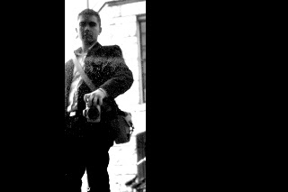

# El huevo a la vez que la gallina

“¿Qué soy?” Ésta es la pregunta que brota de la ilusión de una frontera, la cerca que encierra lo que se cree poseer, la línea que separa todo aquello que experimenta las circunstancias y crea las acciones. La ilusión de una frontera, una simple ilusión.  
No observar la interconexión, la interdependencia mutua de ideas, pensamientos y sistemas materiales, desemboca en perspectivas que entienden la realidad en términos de causas y consecuencias, acciones y reacciones, individuos y circunstancias. Pero no es más que el “antes el huevo o la gallina” de la vida. No hay más que espejos enfrentados todos ellos entre sí. ¿Quién puede decir qué es reflejo de qué?  
La Teoría de la Relatividad pulveriza el concepto de sincronía, amenazando el sentido mismo de la causalidad; la Mecánica Cuántica expresa la incapacidad para determinar sistemas que supone la interacción del observador; las Matemáticas, como demuestran los Teoremas de Incompletitud de Gödel, no pueden expresarse a sí mismas y mantener su solidez.  
Si algo soy, es la fuerza que busca romper esa frontera. Y se rompe como se rompe cualquier otra ilusión; mirándola muy de frente y contestándole: tú no existes”.  
  

  
Más aún en:  
  
<http://delightfulobservaciones.blogspot.co.uk/2011/10/sobre-la-consciencia.html>  
<http://delightfulobservaciones.blogspot.co.uk/2013/01/la-historia-del-universo-en-una-sola.html>
  

<http://delightfulobservaciones.blogspot.co.uk/2011/10/gatos-de-schrondringer-pensamientos.html>  
<http://delightfulobservaciones.blogspot.co.uk/2012/11/mecanica-cuantica-y-recursividad-como_13.html>
