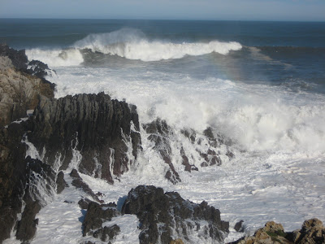

# Desayuno cantábrico

Desayuno frente a ti,

Mar Cantábrico;

tú no me ves, ni yo
alcanzo tus espumas;

pero sin duda te respiro

igual que tú notas en tus
alas

el dulce crepitar de mi
alma.

Desayuno frente a ti,

sincero Mar Cantábrico,

mientras viertes tu brisa,

florida de mañanas
tardías,

por las estancias de este
bendecido hogar.

Y, desayunando frente a
ti,

dulce Mar Cantábrico de mi
corazón,

me entrego a tus verdes
colinas suaves,

me empapo de la luz velada
de tu aire.

Porque tú, mi querido Mar
Cantábrico,

sabiéndome hijo de las
duras montañas

y los chopos de los
campos,

me tomas en tus infinitos
brazos

como a una ola más.

