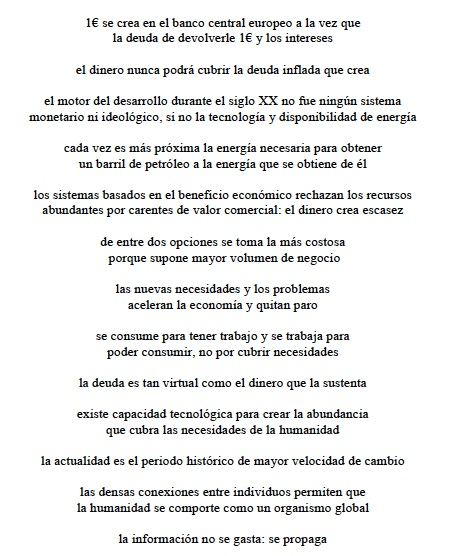

# 12m15m

|  |
| --- |
| Los valores humanos y la tecnología nos liberan de la esclavitud del dinero y la competitividad impuesta. La democracia ha servido para establecer la opresión, pera ahora la expulsará.  Solo pensando como sociedad y observando con astucia los patrones repetidos en el pasado se logrará no morder los anzuelos que devuelvan todo a la situación de partida. |
