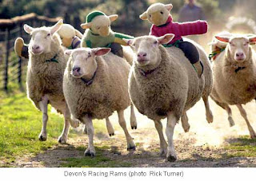
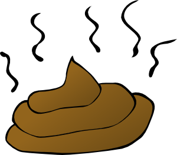

# de un puñado de ovejas, el mejor de los pastores no podrá hacer más que un buen rebaño

La
curiosidad es la necesidad irrefrenable de descubrir: quitar lo que
cubre, es destapar, mirar lo que hay más adentro, más allá. Buscar
y exigir explicaciones a los confines del universo, a las entrañas
de la materia, a lo escondido de la sociedad, lo íntimo de los
sentimientos, lo profundo de la existencia. Cuando se enciende la
curiosidad no cesa en su empeño de abarcarlo todo como un virus sin
más razón de ser que propagarse sin límite. La curiosidad no
necesita de grandes intelectos, si no que es la que los alimenta y
los despliega; tampoco entiende de beneficio ni perjuicio, sólo
desea enfermizamente saber. Por ello su camino es a la majestuosidad
al mismo tiempo que conduce a la nausea. Cuando se necesita conocer,
el universo se acaba quedando pequeño y se vuelve preciso investigar
también dentro de uno mismo. Y se revelan secretos, y los secretos
dejan de serlo.

-->
  

Pero
no hay curiosidad. Lo único que se quiere saber es dónde está no
sé qué dinero. Hasta que no faltó el dinero no hubo preguntas.
Nadie mostró interés por la pobreza hasta que no se interpuso en su
camino. Y repentinamente se propaga la perplejidad de vivir en una
estafa, en una ratonera, de que tendieran una emboscada sin avisar y
que, además, no tengan intención de dejar escapar. La sorpresa de
averiguar que en los bancos no hay dinero, que la policía no está
para defenderte, que el ejército sirve para mantener al gobierno,
que una constitución no mencione nada acerca de la moneda, que la
deuda se salda creando una deuda mayor, que se destruyen alimentos
para vender el resto más caros... estando todo ello explícitamente
respaldado por nuestras excelsas constituciones y leyes, solo se
justifica en no haber reparado en ello nunca antes. Sin curiosidad no
importa nada, por lo que todo puede suceder. Habrá esclavos, habrá
miseria, habrá vidas rotas, habrá egoísmo. Habrá llegado hace
mucho, y quizá alguien no lo vea todavía. Nadie quiere ver que las
personas hacen daño porque el dolor rebosa en sus corazones; nadie
quiere ver que, mientras los ricos quieran lo de los pobres y los
pobres lo de los ricos, habrá guerra; nadie quiere reconocer que sus
propias decisiones tienen repercusión, porque la responsabilidad les
quema en las manos. Quiero ver mañana aviones haciendo llover
monedas sobre las ciudades para ver al mundo arrastrarse. Quiero ver
un mundo callado mientras mira de frente el vacío de sus vidas.
Quiero oír a la gente decir que el mundo es injusto pero que no es
culpa de la podredumbre de sus hogares. Quiero oír de sus bocas eso
de “no te fíes de la gente” para contestarles que solo un alma
abierta puede llenarse.

Hay
héroes grandes y pequeños, voces en la oscuridad, luces en medio
del silencio. Sí, los he visto. Pero de un puñado de ovejas, el
mejor de los pastores no podrá hacer más que un buen
rebaño.

Y
yo me pregunto, obsesivamente, por qué las cosas en esta arrogante
especie homínida se distribuyen de modo tan irregular, amontonando
la basura y la riqueza en órdenes de magnitud vomitivos. Me lo
pregunto de un modo tan compulsivo como la manera en que aparto de mi
pensamiento la evidente respuesta: porque la humanidad ejerce
inevitable y constantemente su derecho de autodeterminación. Así
proclamamos a los cuatro vientos la injusticia de nuestra identidad,
la incapacidad de ser una especie a la altura de sus espectativas, la
ausencia total de voluntad de saber qué ocurre ni afrontar los
cruces de caminos. Mientras no haya necesidad de ver ni valor para
descubrir, habrá más de lo mismo: mientras no haya curiosidad, no
habrá nada.

Relacionadas:  
  
<http://delightfulobservaciones.blogspot.co.uk/2012/11/no-es-justo-yo-fui-la-huelga.html>  
<http://delightfulobservaciones.blogspot.co.uk/2012/09/do-not-fuck-with-us.html>
