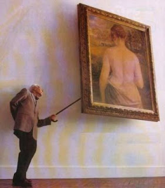

# from a fistful of sheep, the best of the shepherds will not be able to make anything better than a good flock

Curiosity
is the unstoppable need of discovering: withdrawing what overlies,
revealing, looking inside, further. To find and demand explanations
for borders of the universe, matter's bowels, what it is hidden in
society, the intimate of feelings, the deep of the very existence.
Since curiosity is lit, it does not stop in its will of surrounding
everything just like a virus without any other reason of being that
propagate itself unlimited. Because of that, its path is majesty
while it drives to the nausea. When knowledge is demanded, universe
becomes small so oneself investigation it is required as well. And
secrets are revealed, and secrets leave being it.

But
there is no curiosity. Only thing is wanted to know is where is I do
not know what money. Until money lacked, there were no questions.
Nobody cared poverty until it approached its way. And suddenly the
perplexity of living a cheating, a trap, is propagated, of that
someone arranged an ambush without advertising in advance, moreover,
they have no intention of setting free. The surprise of realizing
banks keep no money, police is not there for defending you, that
army's function is keeping government, that a constitution makes no
mention on currency, debt is payed taking a bigger debt, food is
destroyed in order to sell rest more expensive... being all that
explicitly supported by our sublime constitutions and laws, it is
only justified by have not taking account of that never before. There
will be slaves, there will be misery, there will be broken lives,
there will be egoism. There will be arrived long time ago, and maybe
someone has not seen it yet. Nobody wants to see that a person hurts
another because pain overflows its heart; nobody wants to see that,
while the rich wished what the poor have and the poor what the rich
own, there will be war; nobody wants to acknowledge its own decisions
makes a difference, for responsibility burns their hands. I am
willing to see planes dropping millions in coins over cities and
watch the world crawling. I am deserving to watch a world silent as
it looks into the void of their lives. I want to hear people stating
world is unfair but not because of the rottenness of their homes. I
want, I am willing to hear from their very mouths that “do not
trust anyone” and answer them only an open soul can be fulfill.

There
are big and small heroes, voices in darkness, lights in the middle of
the silence. Yes, I have seen them. But from a fistful of sheep, the
best of the shepherds will not be able to make anything better than a
good flock.

So
I wonder with obsession why things in this arrogant hominid species
distribute so irregular, stacking trash and wealth in emetic orders
of magnitude. I wonder it in such an obsessive way as the manner in
which I set aside of my mind the evident answer: just because
humankind exercises inevitable and constantly its right to
self-determination. So we proclaim from the rooftops the unfairness
of our identity, the inability to be a species at the level of its
expectancies, the utterly absence of any will to know what happens,
nor to face any cross-road. Whilst there were not any need to see or
any courage to uncover, there will be more of the same: whilst there
were no curiosity, there will be nothing.

