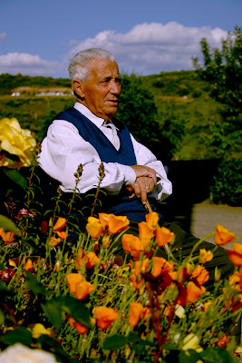

# Segundo y Secundina

A mi Agüelina

Un
par de caradas

y
galletas con miel

a
la hora de la merienda.

Hay
jamón para quien no lo quiera

y
caricias para todos,

tus
rosinas encarnadas.

Decían
tus manos que la vida es sufrimiento

pero
yo te gritaba

que
de suave que era la piel

se
te quería echar a volar de los nudillos.

Geranios
limoneros y malvarriales en el patio

“¡Llora,
rosina, llora, que lo que lloras

no
lo meas!”

Y
yo que quería ser mayor,

y
yo que me iba a morir.

Pero
luego, a la hora de la merienda,

un
par de caradas, abreboca,

y
galletas con miel,

mi
rosina encarnada.

Hay
rostros que hablan

de
infancias entre ovejas y vacas,

de
increíbles mañanas heladas,

de
sangre de la herida trillando el cereal.

Hay
manos repletas,

repletas
de lo que no hubo

recordando
panes mohosos con cebolla,

dorsos
brotados de soles de África.

Hay
también miradas

que
recuerdan largos caminos cien veces recorridos,

un
runrrún de granadas y fusil

al
lado de la cena

y
carretas de sainete y entremés,

y
canciones que ya nadie conoce

y
cheiras, y bimbas y jostras...

… pero
hay miradas, como la de mi abuelo,

que
sonríen brillantes por guardar

un
as en la manga.

Como
la mirada de mi abuelo,

de
mi abuelo Segundo.

Yo
sé que las vidas, como las olas del mar,

vienen
y van.

Sé
que las almas, como a las velas de los barcos,

son
los remolinos que las hinchan.

Remolinos
que, antes o después,

se
deshilachan de sus vientos

para
volver al inmenso aire

al
que siempre pertenecieron.

