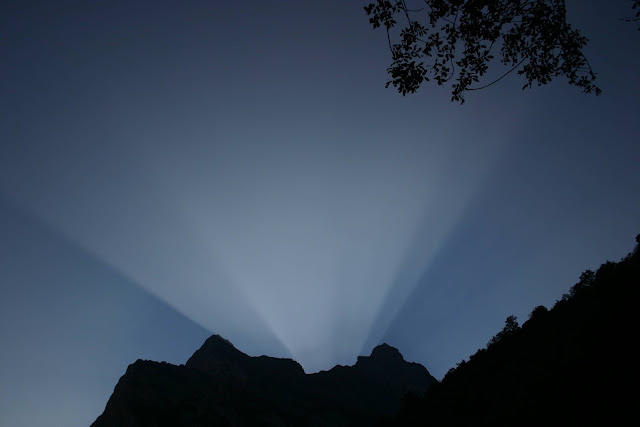

# Ley Natural del Tamaño

Ciertos
montes presentan la cualidad abrumadora

de
rozar delicadamente las nubes más altas,

ciertos
montes que no es más correcto

atribuir
a la tierra

que
al cielo.

Sin
embargo, hay quien los describe

como
discreto montoncito de piedras

sobre
el cual subió en busca de límites

y,
aún así, no encontró nada nuevo:

tras
el horizonte, no hubo si no

más
horizontes similares.

La
misma paradoja se puede trasladar a las sortijas

con,
a penas, extensión para envolver un exquisito anular

cuando
a fuerza de quererlas,

a
fuerza de recorrer sus órbitas internas

centrifugan
su insignificante circunferencia

hasta
abrazar, o aplastar, ciertos planetas,

ciertas
uniones.

Tratando
asuntos más evidentes,

cabe
señalar que todo futuro restante

se
puede anotar en un pedacito de papel

como
ya ha quedado demostrado

con
anteriores futuros, repletos de fechas,

de
besos, muertes, lugares y citas.

Entonces
lo llamáis pasado

le
cambiáis el nombre por reducirlo

a
la talla del diario

mientras
que las palabras son las mismas.

Solo
al henchirse de significado tales palabras,

al
inflarse de tacto, capacidad de ser tocado,

abarcar
los sentidos y constituir completitud:

llenar
el universo de instante

lo
llamáis presente.

Del
mismo modo, dos personas

separadas,
lejos, muy lejos

necesitando
millones, miles de millones

de
kilómetros inmensos

para
colocar entre ambos,

no
suponen más que un diminuto vacío

una
desazón indiferente que

nunca
gasta mucho más de un centímetro.

Pero
si se observan otras dos personas

juntas,
cerca, muy cerca

a
menos de un centímetro

una
boca de la otra

el
aire circundante comienza a no ser suficiente

las
miradas se atraviesan transcendiendo

creciendo
sin límite hasta llenar la habitación,

la
Tierra comienza a pesar más y más

todos
los números se quedan pequeños

y
algunos empiezan a faltar de tanto gastarlos.

Creo
que es por la sensación extraña,

y
poco habitual, de ser, de ser en otro,

de
que otro sea en uno mismo,

que
el espacio, por infinito que sea,

parezca
insuficiente

para
algo tan inmenso que no puede más que

rendundar
en su inmensidad.

Por
eso, en medio de toda esta confusión

de
grande y pequeño,

diminuto
y gigante

donde
los números y las distancias

no
aclaran, al fin y al cabo, nada

no
existe más ley

que
la ley del tamaño natural,

simple
por no distinguir más que

lo
que cabe en una mano

y
lo que no.

No
hace falta más,

no
es necesaria otra distinción que

la
de qué hay que llevar consigo,

guardar,
proteger o poseer

o,
por el contrario,

es
nada más para acariciar,

para
tocar, o acompañar en su movimiento.

