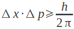
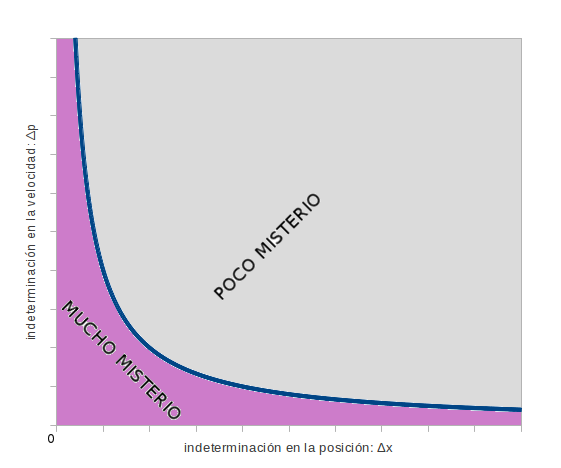
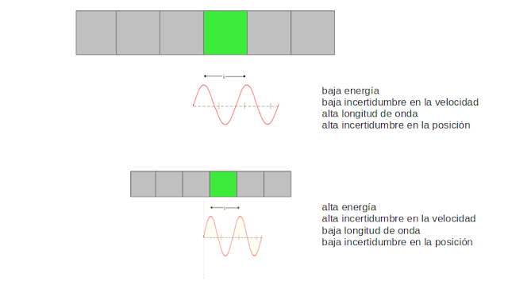
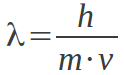
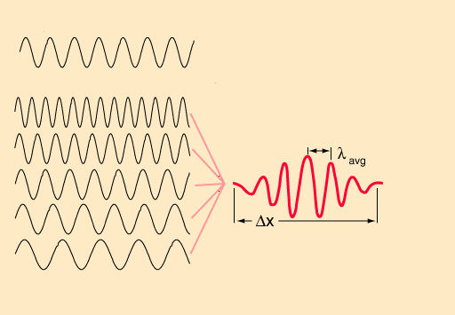
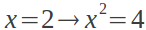
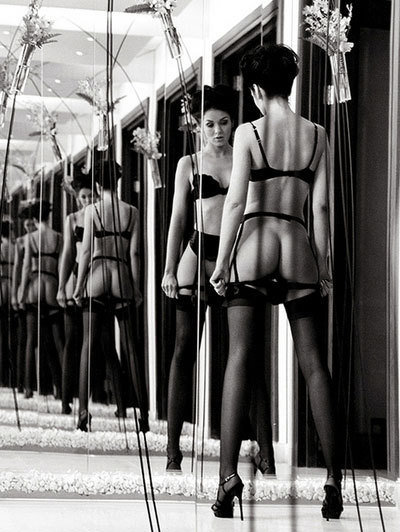
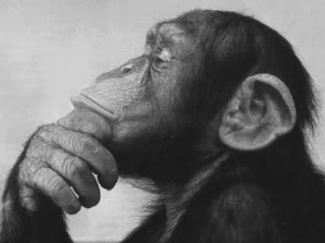

# Mecánica cuántica y recursividad: ¿cómo es la realidad sin ropa interior?

Lo
de la mecánica cuántica es algo muy chungo: todo entorno a ella
parece ser extremadamente complejo, contraintuitivo, inabarcablemente
caótico. Cómo iba ser de otra manera si es fruto preguntar a la
realidad misma: “¿cómo eres sin ropa interior?”. A grandes
cuestiones, grandes respuestas y grandes silencios.

Si
se quiere saber qué ocurre en el universo a un nivel fundamental es
preciso investigar en detalle, experimentar con los componentes
básicos para entender su naturaleza y el modo en que se relacionan
unos con otros. Es un camino largo y tedioso, que lleva siendo
recorrido desde que el hombre se sentó ocioso a ver cómo crecían
sus hortalizas hasta nuestros extraños tiempos modernos, en que
otros se sientan por nosotros a ver las hortalizas crecer. Los
griegos pensaron en el átomo, sin-división, que resultó dividirse
en partículas básicas llamadas protones, neutrones y electrones,
compuestas a su vez de quarks, excepto en el caso de los electrones,
a modo de partículas fundamentales. La sensación general es que no
hay mucho más que dividir en tales partículas elementales, porque
no mencionaré jamás aquí la Teoría de Cuerdas. Así, junto con
otras cuantas decenas de partículas fundamentales, componen una
parte del modelo estándar. Y todo esto, es solo la superficie.

Así,
bajo la superficie, el modo en que las partículas fundamentales se
relacionan es muy curioso porque, para hacerlo, intercambian energía;
pero no como los hogares con la compañía energética, que puede
suministrar 2, ó 3, o 2.5437 kWh. Mientras que las interacciones
macroscópicas parecen ser de carácter continuo, las interacciones
en el mundo subatómico son discretas, por valor de uno o dos fotones
con energías determinadas, pero nunca medios fotones. Por ello la
mecánica cuántica es cuántica, por estar cuantizada. El hecho de
apellidar a esta rama del conocimiento revela la relevancia de este
hecho. Es tan forzado para la mente acostumbrada a la experiencia
cotidiana de andar por casa como la observación próxima de la
televisión, que resulta no ser tan continua y fluida como pretende
ser desde lejos: hay punticos de colores y se encienden y se apagan.
La mecánica cuántica, como la televisión, es engañosa; sin
embargo, como cualquier otro engaño, reside en última instancia
exclusivamente en el engañado.

Si
tratas de desnudar la realidad, te das cuenta de que es una tramposa,
como esa gente a que retas a una partida de strip poker y se pasa la
noche quitándose calcetines. Resulta que, debido a esa naturaleza
discreta y granular del mundo subatómico, no se pueden tocar las
cosas tan delicadamente como se quisiera, se palpa torpemente, se
manosea, modificando todo. A una escala fundamental, la forma más
delicada de obtener información sobre una habitación es meter un
mono y escuchar el ruido que hacen dentro las cosas. La parábola
puede resultar un poco exótica, además de tratarse de una
hipérbola, pero no menos que la ecuación:

En
ella se condensa la incertidumbre, la región oscura de la que no es
posible obtener información: si sabes donde está, no sabes cómo de
rápido se mueve; cuanto más precisa es la velocidad a la que se
desplaza, mayor es la región en la que se puede encontrar. Éste es
el corazón del Principio de Indeterminación, y hay varios caminos
para acercarse a él:

**Camino
A:**

En
referencia al método de meter al mono en la habitación, para
obtener información acerca de una partícula subatómica es preciso
interactuar con ella. Lanzas montones de fotones para tener la
esperanza de que uno de ellos alcance el objetivo deseado, pongamos,
un electrón. Lo detectable es la ausencia del fotón absorbido por
la partícula, delatando su posición. Pero no la posición exacta,
si no una determinada región donde se encuentra. Esa región está
condicionada por la longitud de onda del fotón: a más energía de
la radiación, menor longitud de onda, mayor resolución. (Los
murciélagos necesitan frecuencias agudas para detectar diminutos
insectos, los grandes objetos no obstaculizan las grandes longitudes
de onda de las ondas de radio). La limitación resulta de que para
saber bien donde se encuentra, se requiere disparar muy fuerte,
modificando la velocidad que se pretende conocer. No se puede llegar
a la región de “mucho misterio”, o conocer posición y velocidad
simultáneamente.

**Camino
B:**

Cuando
digo partícula, me refiero a onda; es decir, donde digo onda me
refería a partícula. Bueno, no; o sea, las dos cosas. ¿No? Qué
queréis, esto es mecánica cuántica.

Ésta
es una de las ecuaciones que le gusta manejar al recluso medio de
instituto: fácil de despejar, de primer grado y con pocas letras. Ya
sabéis, rollo Ley de Ohm... Pero para el pobre atormentado que
pretende ir más allá de calcular un valor y pasar al siguiente
ejercicio, supone una sutil y discreta contradicción que le
perseguirá durante interminables y entretenidas horas de reflexión.
Gracias al amigo de Broglie, desde 1924 tenemos que aceptar que las
cosas con masa, al moverse, se comportan como ondas. Y ofrece,
además, al recluso medio una fórmula para saciar su ansia de
calcular, valga la longitud de onda. Más tarde y a modo de
comprobación, alguien observó que los electrones se difractan, como
toda buena onda.

Si
el tormento de esto no es suficiente, cabe ahondar el masoquismo. Si
se pretende determinar la posición de una partícula, pero ésta
resultó ser una onda: ¿dónde demonios puede estar una onda? No es
algo local, ni un punto en el espacio, si no una perturbación que se
propaga en el espacio.

El
modo en que esta curiosa disciplina trata las ondas-partículas es
mediante un mecanismo denominado transformada de Fourier, consistente
en entender ondas de cualquier aspecto como suma diversas ondas
senoidales, que son matemáticamente simples, cada una con su propia
longitud de onda. La siguiente imagen es muy gráfica a la hora de
expresar este procedimiento.

El
mecanismo es muy útil para convertir una onda senoidal, que se
extiende ilimitadamente, en algo localizado, designado habitualmente
como pulso, similar al representado en los monitores que siguen el
ritmo cardíaco. A medida que se añaden más ondas se hace posible
acortar el pulso hasta el nivel requerido. Sin embargo, la región de
“mucho misterio” siempre se aleja de nuestras manos justo cuando
parecía que se la iba por fin a atrapar. Y es que cada onda que
contribuye a acorralar el pulso, supone una nueva longitud de onda
que entra en juego; y eso, amigo mío, es una nueva y distinta
velocidad, como recuerda el amigo de Broglie en su, tan incómoda
como comprobada, fórmula magistral. Para determinar dónde, es
preciso renunciar a cuán rápido. Nótese que, desde esta
perspectiva, la total definición de la velocidad, en el caso de una
única longitud de onda, representa una deslocalización total de la
partícula.

**Camino
C:**

Voy
a intentarlo pensando en la función de onda de una partícula. De
esto ya se ha hablado anteriormente en anteriores entradas ([Gatos de Schröndringer, pensamientos cuánticos e, incluso, petirrojos magnéticos](http://delightfulobservaciones.blogspot.com.es/2011/10/gatos-de-schrondringer-pensamientos.html)), y se decía que mi querido Schröndringer elaboró una
exitosa ecuación exquisita que relacionaba la posición y o la
velocidad con el tiempo para una partícula con una energía dada. Es
decir, capaz de predecir para un instante dado, dónde y cuán rápido
estará y se moverá la partícula estudiada. Pero lo más importante
es que por fin se alcanza la región de mucho misterio, quedando
determinadas perfecta y precisamente ambas escurridizas magnitudes de
una sola vez. Es un mecanismo totalmente determinista, en el sentido
de que para un estado inicial, ¡ofrece un resultado único y
absolutamente definido!

Si
has sospechado, es que has aprendido que la realidad es una tramposa.
Y siempre le quedan calcetines que quitarse... Los valores
maravillosos que nos brinda resultan ser, !números complejos! ¿Qué
quiere decir un electrón cuando afirma estar a 2-0.25i centímetros
de tus narices? Nadie lo sabe, pero lo afirma tajantemente. Entonces,
parece irrelevante todo esto de Schröndringer si no se entiende el
resultado de su herramienta de cálculo. La respuesta es, que sin que
se sepa por qué, mediante un simple mecanismo, la ecuación pasa a
ofrecer un resultado diferente: calcula la probabilidad de que la
partícula se encuentre en una determinada posición en un momento
dado. Como no podría ser de otra manera, las probabilidades son
exactamente consistentes con las imprecisiones derivadas del
Principio de Indeterminación. ¡Maldita magia cuántica!

La
transformación fundamental de representar una oscura e inaccesible
determinación de la posición en una palpable y medible probabilidad
se refiere como colapso del vector de estado, y parece ocurrir
siempre, siempre, siempre que se interactúa con la partícula. Es un
concepto muy controvertido, origen de discusiones de gran alcance,
todas ellas casi fuera de la región donde está claro que se habla
de conocimiento científico, más bien dentro de lo que a uno le
gustaría que fuera. Ya dijo Richard Feynman que no creía que nadie
entendiera la mecánica cuántica. Como no podemos quitar la ropa
interior a la realidad, nos entretenemos imaginando cómo será, pero
no me parece el momento ni el lugar de hablar de cómo paso el rato.

El
procedimiento que transforma lo determinado en probable, lo
incomprensible en tangible, la posición en probabilidad de estar, es
un mecanismo muy simple y aparentemente inofensivo, pero que posee
uno de los matices más relevantes de la experiencia de la realidad:
es la magia de elevar al cuadrado. Sé que muchos esperabais algo más
exótico y que en cierto modo es decepcionante: observad con
atención.

Elevar
al cuadrado, en primer lugar, transforma muchos números complejos en
reales (i2=-1),
todos según se realiza en el caso de la función de onda, salvando
la incomodidad de que los resultados sean de naturaleza compleja. Es
más, elevar al cuadrado supone multiplicarse por uno mismo, y esto
es muy serio porque es un proceso recursivo, que es algo muy
peliagudo. No es ningún problema cuando se trata de números; en
cambio, se vuelve potencialmente mágico cuando se realiza sobre
elementos más ricos, como una ecuación:

Ésta
es una transformación nada trivial pues, aunque muchos reclusos de
instituto afirmen con ligereza la equivalencia de ambas, es que una
vez más han olvidado que la segunda posee dos soluciones, x = +2 , x
= -2. Elevar al cuadrado es un proceso que obtiene su magia de la
recursividad de enfrentar algo a sí mismo, capaz de crear algo a
partir de la nada, como espejos que bucean en el infinito de
multiplicarse el uno en el otro, como la cámara que filma su propia
señal en el monitor, como el altavoz que se desboca cantando nada a
su micrófono. Lo mismo puede crear soluciones adicionales que hacer
aflorar incertidumbres que previamente no se manifestaban. “Yo no
estoy escribiendo”, “tú no estás leyendo” y se plasma la
magia de hacer verdad una mentira solo con hablar sobre sí misma.
Esto da para mucho...  
  
  

No
importa por dónde pretendas acercarte a la realidad a esta escala
fundamental: por independientes que resulten los caminos, siempre
acaban muriendo frente al mismo muro, como si algo mágico retorciera
incomprensiblemente las trayectorias para desorientarte mientras te
conduce truculentamente al mismo punto. Hay un choque entre lo que
esperamos de la realidad y lo que somos capaces de encontrar al
destaparla: en el fondo, esperamos que sea algo continuo, pero el
conocimiento actual la muestra con un límite de resolución, que
invita a entenderse como intrínseco; vamos, que no hay más.

Yo
no sé que pensar. Bueno, sí, por eso he escrito todo lo anterior,
que casi sobraría, para lo que, en definitiva, he venido aquí a
decir. No es irrelevante el que la ciencia constituya conocimiento
objetivo, es algo muy gordo porque deja irremediablemente fuera al
observador. No hay problema hasta que se llega tan hondo como en el
caso de la mecánica cuántica, donde el observador y lo observado
están íntimamente relacionados: cualquier medida, o interacción,
no existe más que como entrelazamiento entre lo observado y el
observador. Así, los fotones que yo veré o dejaré de ver, suponen
un único sistema entrelazado cuánticamente con las moléculas de mi
retina hasta el momento en que, fotón u moléculas, se decanten por
haberse tocado o no; del mismo modo, y para no desviar el misticismo
de la situación hacia donde no quiero que vaya, ocurre con un
inanimado sensor de cámara digital o una placa de radiografía.
Entenderlos como observadores, supone excluirlos del sistema
observado. La ciencia, como íntimamente la aceptamos, requiere
hacerlo, y expresa su limitación mediante el Principio de
Indeterminación. Pero la alternativa a la exclusión del observador,
es un terreno de una locura inconcebible, donde la magia lo gobierna
todo, porque sí, la realidad cuando juega al estrip póquer, tiene
calcetines ilimitados, pues esconde en la manga el as de la
recursividad: cuando habla, habla sobre ella misma y es verdad o
mentira según le convenga; si quieres observar todo, tienes que
estar dentro, si observas, dejas fuera al observador. Yo creo que
esto llevó a Gödel a la locura. Con razón afirman quienes meditan
que el único conocimiento, es el autoconocimiento.  
  
  

  
  
Más aún en:  
  
<http://delightfulobservaciones.blogspot.co.uk/2011/10/gatos-de-schrondringer-pensamientos.html>  
<http://delightfulobservaciones.blogspot.co.uk/2011/10/sobre-la-consciencia.html>  
<http://delightfulobservaciones.blogspot.co.uk/2012/04/el-huevo-la-vez-que-la-gallina.html>  
<http://delightfulobservaciones.blogspot.co.uk/2013/01/la-historia-del-universo-en-una-sola.html>
