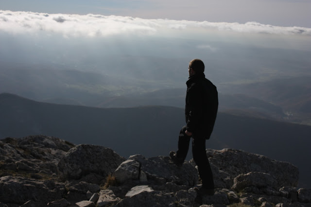

# Desde las cumbres del corazón

Fue
alrededor de la medianoche cuando Zaratustra emprendió su camino
sobre la cresta de la isla para llegar de madrugada a la otra orilla:
pues en aquel lugar quería embarcarse. Había allí, en efecto, una
buena rada, en la cual gustaban echar el ancla incluso barcos
extranjeros; éstos recogían a algunos que querían dejar las islas
afortunadas y atravesar el mar. Mientras Zaratustra iba subiendo la
montaña pensaba en las muchas caminatas solitarias que había
realizado desde su juventud y en las muchas montañas y crestas y
cimas a que ha había ascendido.

Yo
soy un caminante y un escalador de montañas, decía a su corazón,
no me gustan las llanuras, y parece que no puedo estarme sentado
tranquilo largo tiempo.

Y
sea cual sea mi destino, sean cuales sean las vivencias que aún haya
yo de experimentar, - siempre habrá en ello un caminar y un escalar
montañas: en última instancia uno no tiene vivencias más que de sí
mismo.

Pasó
ya el tiempo en que era lícito que a mí me sobrevinieran
acontecimientos casuales; ¡y qué podría ocurrirme todavía que no
fuera ya algo mío!

Lo
único que hace es retornar, por fin vuelve a casa - mi propio
sí-mismo y cuanto de él estuvo largo tiempo en tierra extraña y
disperso entre todas las cosas y acontecimientos casuales.

Y
una cosa más sé: me encuentro ahora ante mi última cumbre y ante
aquello que durante más largo tiempo me ha sido ahorrado. ¡Ay, mi
más duro camino es el que tengo que subir! ¡Ay, he comenzado mi
caminata más solitaria!

Pero
quien es de mi especie no se libra de semejante hora: de la hora que
le dice: «¡Sólo en este instante recorres tu camino de grandeza!
¡Cumbre y abismo - ahora eso está fundido en una sola cosa!

Recorres
tu camino de grandeza: ¡ahora se ha convertido en tu último refugio
lo que hasta el momento se llamó tu último peligro!

Recorres
tu camino de grandeza: ¡ahora es necesario que tu mejor valor
consista en que no quede ya ningún camino a tus espaldas!

Recorres
el camino de tu grandeza: ¡nadie debe seguirte aquí a escondidas!
Tu mismo pie ha borrado detrás de ti el camino, y sobre él está
escrito: Imposibilidad.

Y
si en adelante te faltan todas las escaleras, tienes que saber subir
incluso por encima de tu propia cabeza: ¿cómo querrías, de otro
modo, caminar hacia arriba?

¡Por
encima de tu propia cabeza y más allá de tu propio corazón! Ahora
lo más suave de ti tiene aún que convertirse en lo más duro.

Quien
siempre se ha tratado a sí mismo con mucha indulgencia acaba por
enfermar a causa de ello. ¡Alabado sea lo que endurece! ¡Yo no
alabo el país donde corren – manteca y miel.

Es
necesario aprender a apartar la mirada de sí para ver muchas cosas:
- esa dureza necesítala todo aquel que escala montañas.

Mas
quien tiene ojos importunos como hombre del conocimiento, ¡cómo iba
a ver ése en todas las cosas algo más que los motivos superficiales
de ellas!

Tú,
sin embargo, oh Zaratustra, has querido ver el fondo y el trasfondo
de todas las cosas: por ello tienes que subir por encima de ti mismo,
- ¡arriba, cada vez más alto, hasta que incluso tus estrellas las
veas por debajo de ti!

¡Sí!
Bajar la vista hacia mí mismo e incluso hacia mis estrellas: ¡sólo
esto significaría mi cumbre, esto es lo que me ha quedado aún como
mi última cumbre! -

Así
iba diciéndose Zaratustra a sí mismo al ascender, consolando su
corazón con duras sentenzuelas: pues tenía el corazón herido como
nunca antes. Y cuando llegó a la cima de la cresta de la montaña,
he aquí que el otro mar yacía allí extendido ante su vista:
entonces se detuvo y calló largo rato. La noche era fría en aquella
cumbre, y clara y estrellada.

Conozco
mi suerte, se dijo por fin con pesadumbre. ¡Bien! Estoy dispuesto.
Acaba de empezar mi última soledad.

¡Ay,
ese mar triste y negro a mis pies! ¡Ay, esa grávida desazón
nocturna! ¡Ay, destino y mar! ¡Hacia vosotros tengo ahora que
descender!

Me
encuentro ante mi montaña más alta y ante mi más larga caminata:
por eso tengo primero que descender más bajo de lo que nunca
descendí:

-
¡Descender al dolor más de lo que nunca descendí, hasta su más
negro oleaje! Así lo quiere mi destino: ¡Bien! Estoy dispuesto.

¿De
dónde vienen las montañas más altas?, pregunté en otro tiempo.
Entonces aprendí que vienen del mar.

Este
testimonio está escrito en sus rocas y en las paredes de sus
cumbres. Lo más alto tiene que llegar a su altura desde lo más
profundo. - Así dijo Zaratustra en la cima del monte, donde hacía
frío; mas cuando se acercó al mar y se encontró por fin únicamente
entre los escollos, el camino lo había cansado y vuelto aún más
anheloso que antes.

Todo
continúa aún dormido, dijo; también el mar duerme. Ebrios de sueño
y extraños miran sus ojos hacia mí.

Pero
su aliento es cálido, lo siento. Y siento también que sueña. Y
soñando se retuerce sobre duras almohadas.

¡Escucha!
¡Escucha! ¡Cómo gime el mar a causa de recuerdos malvados! ¿O tal
vez a causa de expectativas malvadas?

Ay,
triste estoy contigo, oscuro monstruo, y enojado conmigo mismo por tu
causa.

¡Ay,
por qué no tendrá mi mano bastante fortaleza! ¡En verdad, me
gustaría redimirte de sueños malvados! –

Y
mientras Zaratustra hablaba así, se reía de sí mismo con
melancolía y amargura.

«¡Cómo!
¡Zaratustra!, dijo, ¿quieres consolar todavía al mar cantando?

¡Ay,
Zaratustra, necio rico en amor, sobrebienaventurado de confianza!
Pero así has sido siempre: siempre te has acercado confiado a todo
lo horrible.

Has
querido incluso acariciar a todos los monstruos. Un vaho de cálida
respiración, un poco de suave vello en las garras -: y enseguida
estabas dispuesto a amar y a atraer.

El
amor es el peligro del más solitario, el amor a todas las cosas,
¡con tal de que vivan!

¡De
risa son, en verdad, mi necedad y mi modestia en el amor!» -

Así
habló Zaratustra, y rió por segunda vez: entonces pensó en sus
amigos abandonados -, y como si los hubiera ofendido con sus
pensamientos, enojóse consigo mismo a causa de éstos. Y pronto
ocurrió que el que reía se puso a llorar: - de cólera y de anhelo
lloró Zaratustra amargamente.

Friedrich
Nietzsche

Así
habló Zaratustra.

