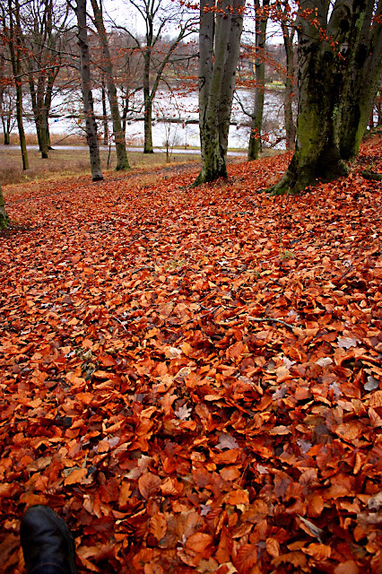

# sus zapatos traen polvo de otros caminos

sus
zapatos traen polvo de otros caminos

El
sol en los ojos

la
brisa en la cara,

sus
zapatos traen polvo de otros caminos;

no
se sabe qué busca

ni
de dónde ha venido.

“Yo
llevo el amargo regusto de las despedidas,

los
salados besos prometidos de lo que está por venir

y
el agridulce sabor de los días que dejo atrás.”

La
mirada recta y transparente,

el
paso tranquilo y firme

de
quienes saben que, aunque el reloj no detiene su latir,

el
tiempo está de su lado.

“Lo
poco que sé, va conmigo

en
el bolsillo del pantalón

y
el sincero afecto de los míos

lo
guardo en el de mi camisa:

muy
cerca del corazón.”

El
roble y el encinar,

el
naranjo y el olivo,

el
girasol y el trigal,

bordean
los pasos de su caminar;

hacia
aquella agreste montaña

él
se dirigirá.

“Si
existe un tal destino

el
mío está allá en el horizonte

porque
aquel monte que tú señalas

clava
en mi pecho su mirar,

porque
en mis entrañas

rugen
desafiantes las olas de algún enloquecido mar,

porque
es mi voz

la
brutalmente arrancada hoja

que
el viento arrastra de aquí para allá.

Así
pues, el camino es mi hogar.

Le
vi pasar

y
no sé aún de qué color es su mirar.

Sólo
comprendí

que
en sus zapatos lleva el polvo de muchos caminos,

porque
es el camino su hogar.

León,
11 de septiembre de 2007

