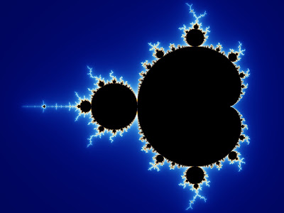
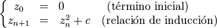

# La Historia del Universo en una sola imagen

-->
  

Esta
noche os voy a contar una historia: la historia del universo. Pero
para hablar de él, es preciso que lo abandonemos para poder así
observarlo. Y, al ser el tiempo algo que le pertenece, lo dejaremos a
un lado por un momento, valga la expresión, para verlo en su
totalidad, de principio a fin, empezado y acabado.

El universo de cabo a rabo en un escarabajo Mandelbrot.

¿Lo
habéis visto? Bien, a modo de recomendación, probad a verlo
escuchando la [sonata número 1 para cello de J. S. Bach.](https://www.youtube.com/watch?v=S6yuR8efotI), como me gusta hacer a
mi. Por si es vuestra primera vez, iré despacio: si os relajáis,
disfrutaréis de placeres jamás imaginados.

La
imagen que muestro arriba para ilustrar la historia del universo es
conocida como conjunto de Mandelbrot, representación de un conjunto
de puntos, un conjunto de los números que son coordenadas de esos
puntos. Los que son de Mandelbrot, son negros; los demás, quizá no.
Antes de nada, es mejor tener claro que esos números son números
complejos, compuestos por dos números de los de toda la vida, por lo
que se pueden representar en un plano si se entienden como
coordenadas.

Pero,
¿qué tienen en común todos esos puntos? Se toma un número. Se
eleva al cuadrado. Se le suma el primer número. Se eleva al
cuadrado. Se le suma el primer número... Así, un millón de veces.
Y luego otro millón de veces. ¿Hasta cuándo? Hasta siempre,
infinitas veces. Es fácil, pero muy aburrido. Sin embargo, solo hay
dos posibilidades: que crezca hasta un determinado límite que nunca
supera, o que se aleje del cero hasta más allá de donde cristo
perdió la chancla. Éstos últimos no valen, no son de Mandelbrot.
Ya está el primer punto de la imagen, ahora hay que hacer lo mismo
con todos los demás. Yo doy dos y otro que haga el resto.

|  |  |
| --- | --- |
| 02+**1**=1  12+**1**=2  22+**1**=5  52+**1**=26  262+**1**=576  … = …  … donde cristo perdió la chancla | 02+**0.1**= 0.1  0.12+**0.1**=0.11  0.112+**0.1**=0.1121  0.11212+**0.1**=0.1125  0.11252+**0.1**=0.1126  … = 0.1126...  **0.1** es Mandelbrot! |

Si
queréis triunfar en los clubes más selectos no lo podéis explicar
tan simplonamente, no está bien visto: hay que decir que el conjunto
de Mandelbrot está formado por los números c que hacen la sucesión
zi+1 = z2i + c , z0 = 0
acotada, cuando i tiende a infinito.

El
conjunto Mandelbrot se pinta en negro. Los otros colores no son un
aderezo hippie new age, si no que se asignan según lo rápido de su
divergir, según su “tiempo de escape”.

Si
alguien se incomoda por no encontrar la relación entre estos números
y la prometida narración de la historia del universo, no desespere:

Ésta
es la historia de cómo la simplicidad se despliega en la más
inabarcable riqueza. Es la historia de la creación de un animalario
de partículas que componen la piel de las manos y las rocas de las
montañas, de la creación de estrellas y galaxias y cuásares y
agujeros negros, de la sofisticación de moléculas hasta albergar en
su seno la información mágica que transforma una célula en un
bebé, de los bits que se subliman en inteligencias siempre inéditas.
Es la historia de la evolución de las especies en perfección nunca
detenida porque cada instante las dejó obsoletas, o de cómo las
civilizaciones florecen y se apagan frenéticamente para dejar paso a
las siguientes, aún más efímeras. Es la historia de las historias
repetidas, hilvanadas una sobre la anterior, pero cantadas al
unísono.

   

El valle de los caballitos de mar.

Porque
el conjunto de Mandelbrot es mapa de la realidad, es un fractal
porque su estructura, que es tirando a fea pues recuerda a un
escarabajo mal hecho, se repite a todas las escalas. Cada
protuberancia que aparece en sus bordes, resulta ser un nuevo modelo
en miniatura del anterior que, por supuesto, contiene más
protuberancias-escarabajo... y así por siempre jamás. Así, su
contorno es infinitamente retorcido, haciendo dudar si quiera que sea
una línea unidimensional tal y como se entiende comúnmente.
Entonces, bucear en sus proximidades ofrece un ilimitado hervir de
escarabajos, caballitos de mar, estrellas y remolinos, islas y
antenas, flores... construidos a base de ellos mismos en miniatura.
Es una historia que se cuenta de arriba a abajo, de dentro a fuera,
de lejos a cerca, y narra cómo la riqueza del universo se eleva
sobre sí misma, a fuerza de repetirse en todos sus rincones.

Un escarabajo sobrino-biznieto y su espiral retucular de escarabajos.

    
En
el comienzo fue la perfección, la redondez. Un instante después
todo se desbocó y, de entre la onda expansiva de intentos de
permanecer, ciertas direcciones resultaron preferentes, creando así
las semillas de lo que estuvo por venir. Y siempre es el mismo
patrón: ubicua y constantemente se transforma la unidad implícita
en multiplicidad explícita. Todo empezó con un vacío, de cuya
tensión se generaron las sutiles heterogeneidades que
minichipisegundos después condensarían en los primeros los quarks,
electrones, gluones... Más tarde brotarían innumerables protones y
neutrones. El instante cero del universo es la simplicidad original,
luego se divide en partes que juegan a combinarse. Esta fase se
representa en el conjunto de Mandelbrot como la primera generación
de escarabajos hijo. La segunda fase tiene lugar a los 200 segundos
de vida del universo, cuando el bullir de partículas condensa en
estructuras más complicadas, protones y neutrones, como si los
escarabajos hijos se cuajaran de una nueva generación de escarabajos
nieto.

Parece que está solo, pero no.

    
Se
observa un patrón, delicioso en su simplicidad, de descomponer y
recombinar en una configuración similar en estructura y sutilmente
distinta en matices: éste es el latir mismo del universo. Porque a
fuerza de repetirse, se rompen núcleos de elementos ligeros para
construir los cimientos del carbono, nitrógeno y oxígeno; a fuerza
de repetirse se rompen las estrellas para sembrar el espacio de
neonatos sistemas solares; a fuerza de repetirse se rompen las
moléculas para formar otras más retorcidas; a fuerza de repetirse
abren en canal las hebras de material genético para recombinarse con
las de la pareja en nuevas formas de vida... Es el latir del universo
en cada rincón, dividir y unir ininterrumpidamente, ubicuamente,
simultáneamente en todos los niveles y, siempre, empujando con
levedad la complejidad.

    

Mirad cómo se enrosca!

Cuando
me preguntan si soy religioso, me suele producir una ansiedad durante
una fracción de segundo en la que decido si voy a dar largas, o a
resultar pesado. No creo en dioses con barba que te dan un ticket en
una nave con 144 000 personas para abandonar el mundo antes de su
merecido apocalipsis, pero se me ha concedido un receptor de la
divinidad que embriaga cada rincón, un alma, valga la expresión.
Muchos físicos teóricos hablan de la partícula de dios, de la
ecuación de dios, de la derivada de dios... bueno, la derivada de
dios no en ese sentido. La idea es que las matemáticas y las leyes
naturales más profundas albergan matices de divinidad, en el sentido
de que representan la fuerza de creación y de gobierno de la
realidad. Cada vez que me abordan estos patrones, un sentimiento
abrumador me llena: “¡estoy observando the very meollo!”. Lo
divino solo es perceptible por lo divino, pero puedo sentir como todo
lo que existe ahi fuera, se replica infinita y simultáneamente en
mi, como en cualquie universo fractal que se precie.

Si
hay algo que se pueda llamar Dios, seguramente se parezca a esto:

  

Simplemente
bello, desplagable en complejidad infinita.

Y otra vez la misma Historia...

Cuando
me preguntan por el futuro, sé que, en su impredictibilidad,
sorprenderá con complejidades que lo ricen más aún si cabe, que se
ramificará cada aspecto difundiendo cada frontera; sin embargo, me
resultará todo muy familiar, como si este escarabajo lo hubiera
visto ya antes... Porque sé que el tiempo no avanza sobre una línea,
si no que profundiza un fractal.

[Para los que habéis atendido como gente aplicada y para los que habéis saltado todo el rollo hasta el final, un regalo.](https://www.youtube.com/watch?v=F_nfHY61T-U)
