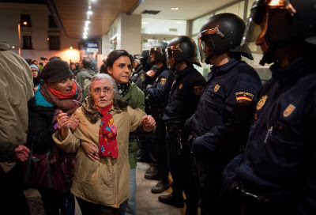

# Hemos vivido por debajo de nuestras posibilidades

-->
  

Hay
algo que me produce náusea. Me produce náusea que echen a personas
de un edificio que estaba previamente deshabitado. Es inaceptable. Es
cierto que quizá en otros casos no, pero las características del
caso que a continuación describiré, señala la profunda podredumbre
de quien sea que esté al mando de España en este momento.

Cito
la noticia,

<https://www.diagonalperiodico.net/movimientos/la-policia-desaloja-alacant-casa-iba-usarse-como-albergue-para-desahuciados.html>

<http://www.diarioinformacion.com/sucesos/2013/01/08/5-detenidos-robo-querian-ocupar-edificio-vacio-desahuciados/1331391.html>

que resumo a continuación.

Entran
unas personas en un edificio que lleva 7 años vacío, desde que se
construyó, pretenden hacer un albergue para personas sin hogar, un
comedor social y un centro de autoempleo... y llevan a la las Fuerzas
y Cuerpos de Seguridad del Estado a sacarlos de allí y los arrestan
por robo. ¿Qué mierda es eso? ¿Pero qué mierda de estado
representan esos indeseables?  
  

Marhuenda, sé que esta imagen no corresponde a la noticia. Efectvamente tienes razón: es de otra de las muchas que podría poner. Gracias por estar en todo.

A
ver, yo he visto gente con mucha cara, gente que no le importa nada
más que meterse el dedo en la nariz y sacarse un moco. Pero el
desprecio de quien sea que manda ahí hacia la sociedad es
simplemente asqueroso. Sé que saldrá mañana un montón de gentuza
abriendo la boca para soltar gilipolleces como que la gente quiere
todo gratis, que hay que seguir unas normas, que si tenemos que dar
confianza e imagen de seriedad... y no sé cuántas más estupideces
que ya todos sabíamos. Lo dirá sin más motivo que cubrirse de
razones para defender todo este montón de despropósitos que se
están cometiendo. Sin entrar en victimismos, me veo obligado a
confesar que me repugna el que echen gente a la calle por no sé que
puñado de euros de los cuales nunca nadie ha visto más que una
mención en el papel de la hipoteca (porque esta sociedad ha
construido casas para todos durante los próximos 20 años con los
albañiles que levantaron a las constructoras), que me avergüenzo de
formar parte de esta especie cuando pienso que hay gente rogando por
comida (porque se tiran peces por la borda y producción agrícola
para alimentar a toda la población, no sea que vaya a bajar el
precio del producto), que hagan mendigar por atención sanitaria
(porque hay médicos y enfermeros jugándose el tipo por seguir
curando), que pretendan que se hipotequen las familias también por
estudiar sus hijos (cuando hay colegios, universidades y profesores
para todos)... No hay tertulianos en todas las cadenas suficientes
para que yo deje de decir que

**HEMOS
VIVIDO POR DEBAJO DE NUESTRAS POSIBILIDADES**

Que
si es lo que se ha votado, que si por favor cumplan con lo prometido,
que si sean buenos con nosotros... A la mierda con eso!

Yo
me he ido del país. El que pueda, no permita más que se rían
de él. El que no pueda abandonarles, que trague con la mierda que le
echen o que se dé cuenta de que ya lo tiene todo perdido y pierda el
miedo: pon el país patas arriba y haz que sea de su legítimo dueño
por primera vez en la historia.

