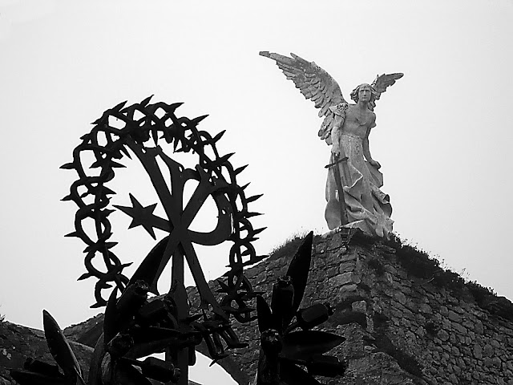

# El Ángel de Comillas

Yo
soy presencia hecha piedra:

  

por
mis venas, que son piedra,

  

fluye
interminable mi latir,

  

que
es piedra.

  

  

Yo
soy el centro de la niebla circundante

  

de
la oscuridad perenne que es el tiempo

  

librado
de su prescindible latir.

  

Yo
soy la mano empuñando la espada

  

alas
desplegadas para no volar

  

fuerza
hecha mirada que, de piedra,

  

atraviesa
transparentes los corazones,

  

que
se estrella en la manifiesta evidencia de las almas.

  

  

Vosotros
venís a mí

  

ofreciendo
esas insignificantes lágrimas efímeras

  

por
un puñado de lo que llamáis pasado.

  

Pero
nunca os corresponde.

  

Los
ojos ciegos no ven más que

  

besos
y caricias degenerando en polvo y ruinas;

  

y
mis manos se quieren apagar

  

de
sostener vuestros gigantes olvidos

  

mientras
me abrazan los amores que ponéis en pie

  

y,
un día, de repente, negáis.

  

Pero
no se apagan, son de piedra.

  

  

Yo
soy luz detenida,

  

mi
materia es viento atrapado

  

y
el rugir condensado de las olas a mi espalda.

  

  

Yo
soy un manojo de mentiras,

  

de
cosas que no son yo,

  

y
en eso nos parecemos,

  

para
que veáis que estoy.

  

Yo
soy quien os espera

  

quien
os abrirá las puertas

  

del
que siempre ha sido vuestro hogar.

  

  

Sólo
entonces dejaréis de negar

  

la
ceguera de que un minuto es distinto de un siglo

  

el
antes otra cosa que el ahora o el después,

  

que
la piedra es efímera

  

y
que, vosotros como yo, sois piedra.

  

*[El Ángel Exterminador](http://es.wikipedia.org/wiki/El_%C3%81ngel_Exterminador_%28Llimona%29 "El Ángel Exterminador (Llimona)")* (1895). Escultura existente en el cementerio de [Comillas](http://es.wikipedia.org/wiki/Comillas_%28Cantabria%29 "Comillas (Cantabria)") ([Cantabria](http://es.wikipedia.org/wiki/Cantabria "Cantabria")).
