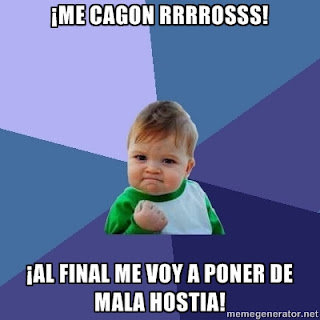

# Do not fuck with us.

Cuando
alguien te jode (pero no de eso que es de vida o muerte, no), cuando
te joden poco a poco, con comentarios porculeros tolerables que
pueden pasar pero que no paran; cuando te tocan la oreja por detrás
y hacen como que no han sido ellos, y al girarte repiten... Y lo que me
revienta es cuando me vienen haciendo haspavientos y me dicen que la
colleja me la comí yo solito por meterme en medio... Se ríen por
lo bajini con sus coleguillas y es como una droga, ¡ya no pueden
parar! Se crecen y planean una que toque más los cojones. Todo va
hacia una dirección concreta: hacia el cachondeo continuo.

Como
en toda situación, existe una secuencia de acontecimientos lógica,
es decir, inevitable: la mala virgen crece en mi seno, me muerdo el
labio de un lado, luego del otro, empiezo a gruñir, se me aprietan
los puños y...

Y
se medio callan por un ratito. Sin embargo, resulta inevitable que
vuelvan poco a poco, con la confianza de ya haber dado por saco
antes, hasta que reviento otra vez. Este ciclo se puede mantener, con
variaciones en la frecuencia y en la amplitud, hasta que se harte la
madre que parió a todos.

Solo
hay un desenlace posible: soltar una castaña que se queden todos
callados con los ojos abiertos y, al primero que pregunte por qué,
otro par de castañas más pistonudas de cada lado. Siempre, creedme,
acaban revoloteando incapaces de explicar cómo alguien puede ser tan
cafre: no intentes, no lo querrán comprender. Inmediatamente,
échalos lejos, suficientemente lejos, asegúrate de que no pueden
volver a merodear tus inmediaciones, porque volverán. A modo de
golpe de estilo y como despedida, mientras los agarras por la pechera puedes soltar un arrogante:

DO NOT FUCK WITH US.

*Tyler
Durden*

Y
para mentes más ilustradas:

"Ningún
hombre es demasiado bueno para [gobernar](http://es.wikiquote.org/wiki/Gobierno)
a otro sin su consentimiento."

Abraham
Lincoln

"Pueblo
que ignora su historia, pueblo que está condenado a repetirla."

Abraham
Lincoln

“Cuando
la injusticia es ley, la desobediencia es deber."

---

“He
hecho por mi país, por la humanidad, todo lo que pude, y ahora
entrego mi alma a dios; mi hija, a mi país.”

Abraham
Lincoln

“El
sistema de la banca nosotros lo hemos reprobado por igual. Yo lo
contemplo como un borrón en todas nuestras constituciones, que, si
no se protegen, terminará en su destrucción, ya que ya están
siendo golpeadas por los jugadores corruptos, y está arrasando en su
progreso, la fortuna y la moral de nuestros ciudadanos.”

Thomas
Jefferson

“Cuando
alguien asume un cargo público debe considerarse a sí mismo como
propiedad
pública”

Thomas
Jefferson

"Pienso
que las instituciones bancarias son más peligrosas para nuestras
libertades que ejércitos enteros listos para el combate. Si el
pueblo americano permite un día que los **bancos privados controlen su
moneda**, los bancos y todas las instituciones que florecerán en torno
a los bancos, privarán a la gente de toda posesión, primero por
medio de la inflación, enseguida por la recesión, hasta el día en
que sus hijos se despertarán sin casa y sin techo, sobre la tierra
que sus padres conquistaron"

Hay
quien dice que de Thomas
Jefferson.  
  
Relacionadas:  
  
<http://delightfulobservaciones.blogspot.co.uk/2012/09/de-un-punado-de-ovejas-el-mejor-de-los.html>  
<http://delightfulobservaciones.blogspot.co.uk/2012/11/no-es-justo-yo-fui-la-huelga.html>
