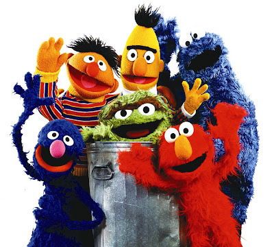
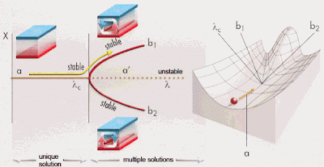
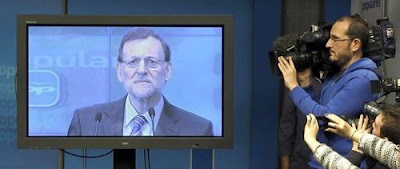
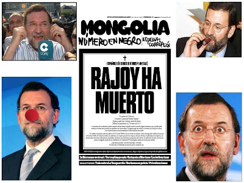

# Éste es el tipo de conversación que tiene la gente mientras su gobierno se derrumba

-->
  

- “Vaya
marrón, eh?

-
(Inaudible)

- Lo
de los sobres.

-
(Inaudible)

- Fú,
ya te digo...

-
(Inaudible)

- Que
no eran solo trajes.

-
(Inaudible)

- ¿Mi
primo? vete olvidándote: me preguntó que si tu bigote era de pega.
¿Sabes, por cierto, que también mi primo se había enterado de lo
de la pantalla? Que ahora el presi te pone el mute por el Skype!!!

-
(Inaudible)

- Vaya
tela...

*-
Risas.”*

Éste
es el tipo de conversación que tiene la gente mientras su gobierno
se derrumba. Muchos pensarán que un derrumbe es demasiado, que es
una fuerte sacudida, que podrán encajar el golpe, y otras tantas
minoraciones que supongan esquivar el encontronazo con un cambio muy
sustancial en la distribución de poderes del país, es decir,
quiénes gobiernan a quiénes, y en qué medida. Pero yo creo
convencidamente que el gobierno de España, y el Partido Popular,
como organización que controla dicho gobierno, colapsará en no más
de tres meses, antes de acabar abril. Un derrumbe consistente en,
como en cualquier sistema centralizado, la eliminación del núcleo,
de las cabezas visibles en el partido y en el gobierno en primer
lugar, pero también del núcleo opaco que, teniendo dominio de la
organización, no forma parte de la vida pública. Si imaginas a
ministros y exministros reclamados por un juez, un jefe de gobierno
pidiendo disculpas y prometiendo como si fuera un simple jefe de
estado: “lo siento mucho, no lo volveré a hacer”, o militares de
alto rango, pero en activo, no como los retirados que hablan en
nombre de nadie como cuando fui yo al Diario de Patricia a contar mi
vida, en un tono que no le permitirías a un desconocido por la
calle; si imaginas eso, ten por seguro que en tres meses te
sorprenderá lo ingenuo que fuiste.

Soy
consciente. Cuanto más confiadamente se expresa una idea, más
fuertemente se desea contradecirla. Pero, aquí tengo mis porqués,
que son menos inútiles que mis qués.

Si
digo que para mí todo esto empezó un lunes por la mañana en el
aeropuerto de Barajas, pues volaba a Londres por motivos de trabajo,
muchos me imaginarían con maletín y corbata organizando unos
informes en mi jaiPaz. Aunque resulta que entraba esa misma tarde a
reponer pescado en un fastfood. Lo importante es que miré gratis las
portadas de algunos periódicos, que es lo que vale, y me ahorré de
paso la publicidad del interior. Y ahí ponía cosas de un partido
que gobierna con mayoría absoluta un país con la economía rota
mientras destruye intensamente bienestar y la esperanza de mejora,
que se dio en llamar Partido Popular. Y que parecía ser que un caso
de supuesta corrupción en el partido y aledaños hace ya cuatro
años, investigado por un juez al que se le inhabilitó por ello,
Baltasar Garzón, volvía a centrar la atención. Ahora, afirmaba el
periódico, repentinamente las evidencias apuntaban a la zona más
poderosa del partido y del gobierno actual y anteriores.

Ese
hecho, lo observé como el punto de no retorno hacia un cambio muy
importante.

Los
neumáticos en la Fórmula 1 (Formula 1 Administraision Limited.
©2013), después de
veinticinco vueltas sin deterioro apreciable, crían ampollas que
hacen pedazos las gomas en menos de tres. Después de un año entero
de perplejidad ante cómo puede sostenerse a pesar de ser sobre quien
pesa la responsabilidad de toda la desesperación y de devaluar su
palabra faltando a todas sus palabras, aparece en el dedo gordo una
ampolla bien gorda. En dos semanas el Presidente del Gobierno sale
ante la prensa en 2-D terminando con un mensaje en la pantalla de
“reproducir otra vez el vídeo” para jurar que él no ha sido
comprado.

Cuando
se pretende responder a la pregunta de por qué todo esto está
sucediendo, las primeras respuestas siempre dibujan algo parecido a
una conspiración. Pero lo cierto es que, con gasolina suficiente, el
incendio es inevitable. Cuando los cambios se apelotonan como si
llegaran tarde, cuando los acontecimientos se precipitan y se suceden
en magnitud creciente los unos sobre los otros, las interrelaciones
se manifiestan clara y maquiavélicamente como si todos los Danes
Brownes se hubieran juntado para escribir la nueva novela de la
década: una trama intrincada e increíble; oscura, por recién
descubierta. El colapso del segundo pie del bipartidismo es este
incendio. Pero la gasolina lleva ya tiempo desparramándose
discretamente, y es incluso más poderosa que Espe y Pedro Jota
juntos. El 15 de mayo de 2011 se inició otra transición, con
minúscula, de todo este proceso, entendida como la inesperada
sincronización de muchas desesperaciones, cabreadas pero más
constructivas de lo esperable. El “15M y los indignados” es solo
un confinamiento, necesario para entendernos al hablar y para
atacarlo sus amenazados. Lo significativo es el rechazo de lo que se
vende condescendientemente como bueno para todos, por creer que es
mentira, que es estafa. Los cambios solo se abordan por negación de
lo anterior. Paralela, o subyacentemente, está el tupirse más y más
de la red, achatando la pirámide, en la que asciende menos cada vez
la información para salvar la distancia menguante entre emisor y
receptor, productor y consumidor. Las mentiras ya no caben con tanto
descaro, los espacios designados a ellas se arrinconan, aún vastos.
La peña quiere sangre, quiere leña! La masa se siente decepcionada,
tangada, puteada. Y con razón. Los periódicos no se venden y los de
siempre no se van. Tiran a la plaza pública Urdangarines, Pantojos y
Poceros como los cacos a los perros les echan un chuletón para
entretener, porque están entrando en casa por la puerta de atrás y
a deshora. Y si no es suficiente, se linchará públicamente al
Presidente del Gobierno. Ah, espera, que eso ya se ha hecho...

Las
conspiraciones se abrazan porque restringen a pequeños espacios
lejanos las causas y las responsabilidades, pero todo ello está más
cerca y esparcido de lo que se quiere aceptar. Si tú no quieres un
gobierno, y el de al lado tampoco, y así por todos sitios, ese
gobierno simplemente se va. No importa que haya veredicto de juez, ni
foto de Rajoy cogiendo el sobre de la mano de Bárcenas: la masa
quiere creer que es cierto y esa será la imparable verdad. La masa
querrá verlo fuera y muchos serán arrastrados con él. Merkel
dejará de verlo útil, los de los sobres entenderán que es momento
de buscar otra gente a la que ofrecerlos, los aspirantes a diputado
entenderán que han de volver al infojobs de la política.

Los
sistemas complejos, los conjuntos de muchos agentes relacionados unos
con otros, evolucionan intercalando estados de equilibrio prolongados
con regímenes transitorios bruscos. Las glaciaciones duran decenas
de miles de años, pero el periodo de transición del clima normal al
glacial es tan solo de decenas de años, a pesar de que las causas
profundas de la glaciación son muy progresivas. En medio no hay
equilibrio y el salto solo puede ser rápido. Lo de que todo ocurrirá
en tres meses era solo un recurso biblico-literario para impresionar
al principio, pero lo que creo firmemente es que será rápido.

¿Cómo
será el nuevo equilibrio? Difícil de preveer, par mi. Pero el
derrumbe del bipartidismo... uf. Es gordo. La mitad conservadora del
dúo, por su inercia intrínseca, era de esperar que cayera la
segunda. Quizá alumbre una subcontrata ultraconservadora y otra más
mediocre aún, pero en política 1+1 < 2. Por otro lado, fundar
oficialmente el PPSOE, como coalición... tendría poco tirón. Por
encima de toda elucubración, una cosa es cierta: alguien ofrecerá
algo. Cuando se ven muy acorralados suelen ofrecer miedo+protección,
otros se decantan por cambios audaces, callejones sin salidas,
descampados sin señalizar... Muchas cosas habrá en el menú
pronto. Veremos cuánto hemos aprendido, con qué nos conformamos,
qué capricho se nos antojará, cuán agudos podemos llegar a ser.

Relacionadas:

<http://delightfulobservaciones.blogspot.co.uk/2012/09/do-not-fuck-with-us.html>

<http://delightfulobservaciones.blogspot.co.uk/2012/11/no-es-justo-yo-fui-la-huelga.html>

<http://delightfulobservaciones.blogspot.co.uk/2013/01/hemos-vivido-por-debajo-de-nuestras.html>

<http://delightfulobservaciones.blogspot.co.uk/2012/12/cierra-los-ojos-y-abre-la-boca.html>
