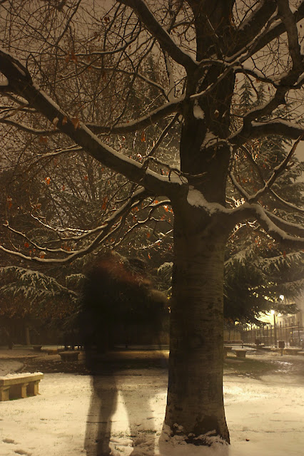
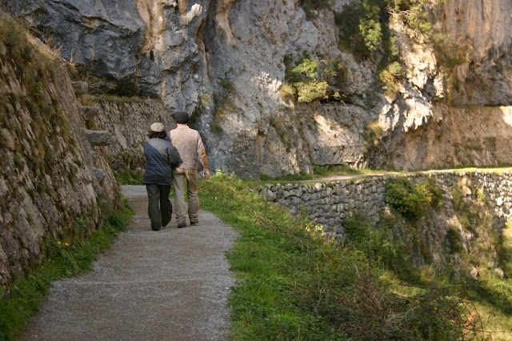
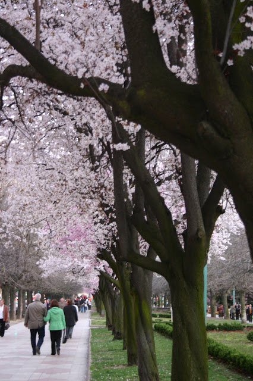

# Dímelo con tus manos

-->  

Dímelo
con tus manos

calladas
como las nubes por el cielo,

silenciosas
como los rayos de sol

que
nos envuelven la piel.

Entreábremelas
muy despacio,

esas
tus palmas, pausadas estrellas

que
no se acaban, ni se gastan,

ni
se van, amor.

Entreábremelas
y bésame con ellas

las
manos mías.

Porque
no hay beso más sincero

que
ese nuestro de una yema

posada
en una palma.

Verás
como no hace falta más

que
sostener tu carita fina

con
mis enamoradas manos

para
comprender que ellas

no
saben mentir,

que
no entienden de promesas ni de planes

si
no que hacen y dan

y
se dejan dar, reciben caricias

y
guardan secretos de papel o pequeños latidos.

Así,
las manos desnudas

sin
pinturas, ni relojes ni anillos ya,

los
cuales atan nada más

a
un nombre, a una hora

o
a alguna apariencia disfrazada,

nos
las podremos colmar de tacto

y
de sincera materia.

Por
eso, al abrir los ojos

podremos
verlas, al fin, amor,

llenas.

Gerona,
19 de mayo de 2008.

[Para quienes aman, y para los que están dispuestos a hacerlo.](https://www.youtube.com/watch?v=1O1dwSm11hI)

Más aquí adentro:

<http://delightfulobservaciones.blogspot.co.uk/2013/01/el-angel-de-comillas.html>

<http://delightfulobservaciones.blogspot.co.uk/2012/12/sus-zapatos-traen-polvo-de-otros-caminos.html>

<http://delightfulobservaciones.blogspot.co.uk/2012/05/desayuno-cantabrico.html>

<http://delightfulobservaciones.blogspot.co.uk/2013/02/sueno-desde-el-puente-de-brooklyn.html>
