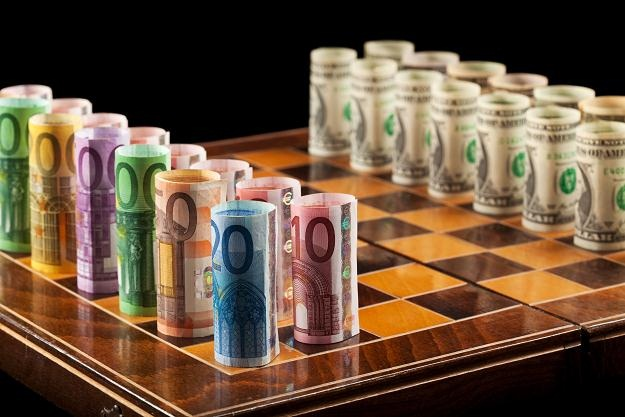
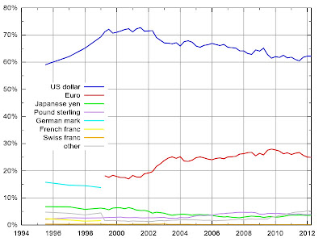
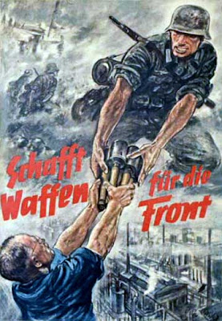

# Si esto no es una economía de guerra, es la mayor cagada del mundo moderno.

-->
  

A veces me paro a pensar. Quiero
entender hacia dónde va todo, pero siempre hay un barullo de muchas
cosas ocurriendo en diferentes niveles que se solapan en un
galimatías que no parece tener pies ni cabeza, principio ni fin,
causa ni finalidad. Sin embargo, a veces sueño. Y en mi sueño todo
aparece tan claro, tan inevitable, tan consistente y coherente... tan
decepcionantemente estúpido como emplear el mundo en elevar
castillos de naipes para erigirse dueño del más alto esperando que
el de al lado muera en el intento. El sinsentido ineludible de vivir
en un duelo de coches acelerando hacia el precipicio esperando que el
otro se acobarde: todo para uno, o los dos al hoyo. Y, además,
vivirlo en el asiento trasero: qué cutre.

E.E.U.U y U.E.E. peleando
encarnizadamente por encumbrar $ o € para dominar la riqueza del
mundo. La pelea viene de lejos, llegándose a las manos en la Segunda
Guerra Mundial, pero es que hoy no se pueden permitir el lujo si
quiera de hacer la guerra, un coste inasumible en la carrera de
reforzar la moneda. Que tu moneda sea empleada como moneda de reserva
internacional te convierte directamente en el rey del mambo. Durante
las últimas cuatro décadas, el dólar estadounidense ha sido la
moneda dominante en el mundo, pues casi todo el comercio
internacional se ha realizado empleando dicha divisa con la finalidad
de ahorrar las comisiones de cambio, ya todos la tienen. Hay dos
razones principales para que tantos países se decantaran por el
dólar y no por otra moneda: ofrecía solidez por estar respaldado
por una nación con pocas expectativas de quebrar y porque elegir
otra divisa te inscribía automáticamente en el Eje del Mal, con
dramático desenlace. Esto es la gallina de los huevos de oro: todo
el mundo desea tu moneda, te da petróleo, metales y lo que pidas a
cambio de unos papeles que te resultan gratis. Quien controla la
moneda de reserva tiene endeudamiento ilimitado porque puede imprimir
dinero hasta que el resto del mundo se canse.

Composición de divisas mundiales para cambio internacional.

A los banqueros alemanes les salió mal
la jugada y perdieron la Segunda Guerra Mundial, pero ésta vez
volvieron a ver clara la oportunidad: el principal respaldo del
dólar, el petróleo, el recurso más crucial en nuestro tiempo,
comienza su declive tras el pico de producción mundial, previsto
desde los 80 para un momento entre 2008 y 2016. Para entonces habrá
un tal Euro que ha de presentar suficiente solidez como para
aprovechar la maravillosa oportunidad de no ser menos confiable que
el todopoderoso dólar y reemplazar el Viejo Dominio por el Nuevo
Dominio, el Euro como primera moneda de reserva mundial. Pero, ¿cómo
hacer fuerte al Euro? Con gente suficiente para empujarlo: aquí es
donde entramos tú y yo. “Una Europa de todos”, “cuna y paraíso
de la democracia y la libertad”... y todas esas tontadas que hemos
oído a patadas con un himno fraternal de fondo. El primer paso es
poner el dinero suficiente, luego, gente a trabajar por él. Esos dos
pasos se dan juntos, pues crear Euros crea deuda. Cuando hay
suficiente divisa, paras la máquina de imprimir y quedan las deudas,
que no podrán ser pagadas, deudas que fueron recibidas con los
brazos abiertos en los estados miembros bajo el pseudónimo de
créditos baratos y que son colocadas en sus contribuyentes tan
pronto como sea posible. Las hipotecas a precio de burbuja son
maravillosas a tal efecto, así como la nacionalización de bancos
podridos. La gente endeudada trabaja fantásticamente, no porque les
dé superfuerza, si no porque trabajan por menos de la mitad de
sueldo que un trabajador equivalente sin deudas. Mientras, puede ser
muy beneficioso para la solvencia del estado vender sus instituciones
e infraestructuras, que da liquidez y materializa la magia de que los
usuarios paguen otra vez más por los servicios, ya que hay que
volver a amortizarlos. Por otro lado, las organizaciones financieras,
afines al proyecto del Euro como moneda de reserva, tienen derecho a
ser depositarias de la riqueza de la Zona Euro, parasitando un 5% del
flujo de dinero cada vez que los estados requieren financiación. Ese
5% es orientativo y hace referencia a la resta entre el 6% de
intereses que paga un país apurado al banco privado y el 1% de
intereses con que el este banco lo recibe del BCE: ¿magia, o
chulería? Y una cosa más: la inflación es pecado. Merkel, del
partido democristiano alemán, es fiel a su fe de que no puede salir
un solo Euro de su banco central mientras no le hayan firmado los 26
restantes que no lo utilizarán en otra cosa que no sea sanear sus
cuentas. Para no permitir sobrepasar el estricto umbral de inflación,
cada Euro que sale del BCE lo hace al borde mismo de la muerte, con
hordas de agentes económicos peleándose por la oportunidad si
quiera de tocarlo. Porque el valor del Euro no puede bajar, la
confianza no puede quebrantarse y el contribuyente europeo tiene la
misión de comer una vez al día, pagar canon de inspiración y
espiración, trabajar gratis por sostener cada estado miembro, cada
grupo financiero en que se ensalza La Moneda Única. Además firma
que lo hará de por vida y así lo harán sus hijos y los hijos de
sus hijos. Si esto no es una economía de guerra, es la mayor cagada
del mundo moderno.

Por su parte, el contrincante pelea por
los últimos reductos del, antaño imprescindible, petróleo. Irán
es muy malo. Por eso E.E.U.U. y sus socios nos lo recuerdan cada día
varias veces. Sin embargo, es consciente de que en cuestión de
petrodólares, el tiempo juega en su contra. Por dentro, siguen la
misma carrera loca de transferir riqueza de los contribuyentes a los
bancos, hedges funds y tal y tal... cargando las deudas de su batalla
financiera a estudiantes, propietarios y pacientes. Por fuera,
hirieron gravemente al enemigo atacando uno de sus puntos más
débiles: Grecia. Goldman Sachs estuvo dentro como un caballo hueco
de madera en una cuidad amurallada desde el comienzo, y las agencias
de calificación dispararon cuanto fue posible. Y mucho credit
crunch, que cuantos menos dolares lleguen a consumidores y empresas,
más estarán dispuestos a hacer por conseguir un par de ellos, así
son más valiosos. Me recuerda a una película donde un chulo daba
jaco a sus empleadas al entrar en la empresa, pero poco tiempo
después, ya sabéis cuánto les pedía a cambio de una pequeña
dosis.

Destruir lo que uno es por dominar los
escombros de tu vecino, esa es la fuerza que mueve nuestro mundo.
Vaya una mierda. Podemos estar orgullosos.

Para finalizar, una cita de nuestro aún
presidente, Mariano:

“Joderse es de gente seria”.  
  
  
Más aquí:  
  
[Europeos del centro y la periferia, mercancía en manos de nuevos dueños](http://delightfulobservaciones.blogspot.co.uk/2011/11/europeos-del-centro-y-de-la-periferia.html)  
[Petro-crack: nos frenan porque los cambios se les quedan grandes](http://delightfulobservaciones.blogspot.co.uk/2012/04/petro-crak-nos-frenan-porque-los.html)  
[Hemos vivdo por debajo de nuestras posibilidades](http://delightfulobservaciones.blogspot.co.uk/2013/01/hemos-vivido-por-debajo-de-nuestras.html)  
[¿Soy más rico que Fernando I de Aragón?](http://delightfulobservaciones.blogspot.co.uk/2012/02/soy-mas-rico-que-fernando-i-de-aragon.html)
