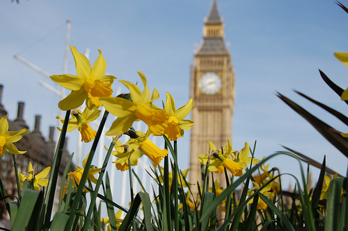

# Valientes flores amarillas en Londres

Miles
de valientes flores amarillas han brotado por todo el Parque de Acton. Tan
valientes como los árboles que se salpican de prometedoras pequeñas
historias: unas en rosas y violetas, blancas las más tímidas.
Alrededor, algunos perros y muchos niños habían campado a sus
anchas a carcajadas por los Jardines del Patio de los Cuervos, como
una Declaración de Independencia de la Escuela de John Bett, hasta
el día siguiente. Mientras tanto, el Puente de Hammersmith había
estado ofreciendo almuerzos al sol junto a él y sobremesas de remo,
además de 2x1 en menús: por lo que me tomé sólo el que era
gratis. Volando en mi rojo 266 a diez pies sobre el asfalto, los
latidos se iban pisando unos a otros y la sangre cabalgaba por mis
venas.  

Eso
es la primavera, expectación de lo inminente. Entonces la nieve
regresó a mi patio; sin embargo, ¿qué frío podría derrotar la
voluntad de amanecer? ¿Cuán fría ha de ser una caricia para
detener la determinación de lo tibio cuando su momento ha llegado?
Eso es la vida, nada más que una temprana flor amarilla. Eso son los
sueños, un vistazo interminable que te mira desde el otro lado. Y
esto es estar vivo, clavar la mirada en los ojos de tu sueño.

*Para mi hermana*

(La prima Annie las reconoció como daffodils, o narcisos.)

Traducción de [Bold yellow flowers in London](http://delightfulobservations.blogspot.co.uk/2013/03/bold-yellow-flowers-in-london.html)
