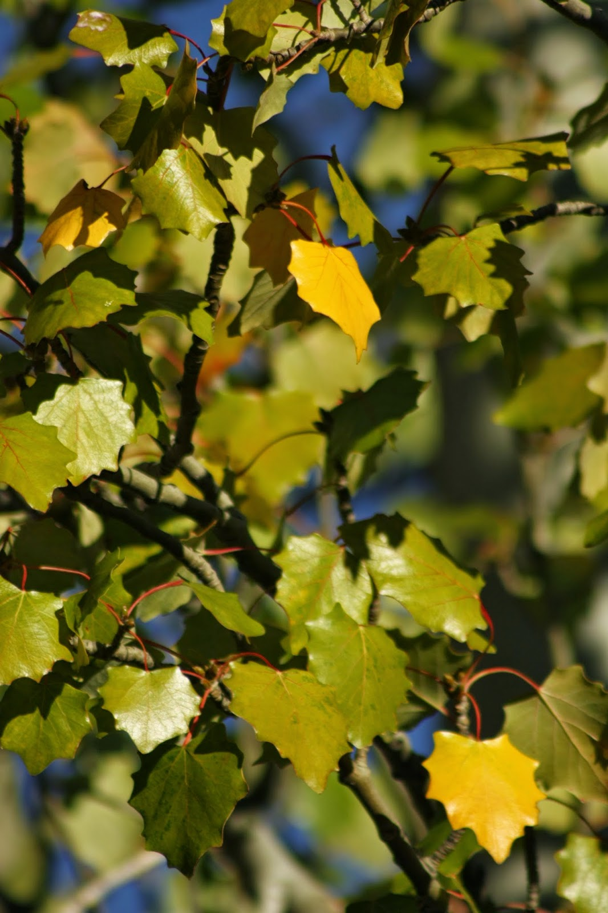

# Fiesta de disfraces

Lo callas, pero sé que tu mirada se dora. Con tu paso suave y determinado retuerces el color de las mejillas.  
Y en tus fiestas de disfraces juegas a no ser, a disimular tus amarillos, a negar que vayas a desnudar. Pero yo sé que no te llamas como dices llamarte.  
Como si por las tardes reclinaras agostos en tus brazos, arrastras minutos o lustras colinas en las que escribes tu nombre en letras cárdenas y sílabas ocres, mientras finges caligrafías.  
Por eso me gustas tanto. Porque me das la oportunidad de parecer ciego. Porque entras sin decir que entras, diciendo que no eres tú, que septiembre será otro que se te parece.  
  

  
  
Desenreda la madeja:  

# [Cuando lo viejo rehúsa hacerse a un lado](http://delightfulobservaciones.blogspot.com/2014/01/cuando-lo-viejo-rehusa-hacerse-un-lado.html)

# [sus zapatos traen polvo de otros caminos](http://delightfulobservaciones.blogspot.com/2012/12/sus-zapatos-traen-polvo-de-otros-caminos.html)

# [La Historia del Universo en una sola imagen](http://delightfulobservaciones.blogspot.com/2013/01/la-historia-del-universo-en-una-sola.html)
