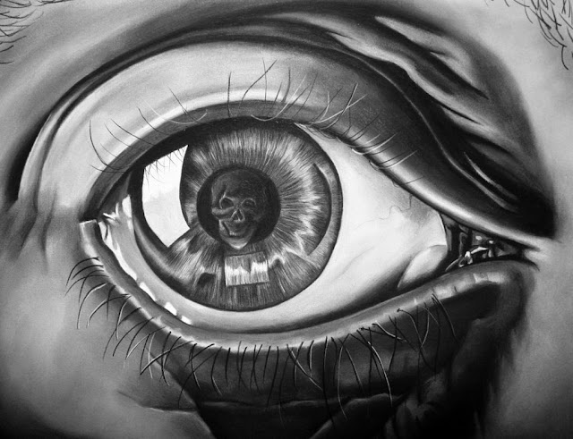

# Quiza no te haya hablado nunca de ellas...

Quizá no te haya hablado nunca de ellas, pero merece la pena prestarles con frecuencia un poco de atención y perseguirlas aunque sea con un puñado de líneas. La verdad es que se mueven con una discreción exquisita que las permite pasar inadvertidas incluso en las conversaciones de muchos observadores experimentados. A veces pienso que es principalmente por su cadencia, aunque sin la combinación de su extrema esbeltez, que les permite resbalar por las rendijas de las puertas más concienzudamente ajustadas, con la textura tan singular de sus contornos, no les sería tan sencillo elaborar una configuración tan sutil. La verdad, como decía al principio, es que llegados a esta fase tan preliminar, la mayoría de los intentos por alcanzar una visión más nítida de ellas termina en una prematura distracción que devuelve todo al punto de partida. Es justamente por esa textura singular, cuya geometría recuerda a los azules de Urano, como de burbujas que fabrican irisaciones cóncavas, por lo que suelen descartarse por la incredulidad hasta del observador más experimentado. Yo las he conseguido retener por algunos segundos, esquivando momentáneamente una sofisticación tan efectiva. Después de varios intentos exitosos, me he convencido de que la forma y la inusual textura de estas criaturas no tiene otro fin que confundirse con la propia imagen de su presa. Otras muchas veces siguen un patrón diametralmente opuesto, cuajado de transparencias incorpóreas, pero repetidas en infinidad de ángulos diferentes; apoyadas así en su naturaleza gregaria alcanzan un nivel de incorporeidad que les permite desplegar todo un repertorio de vacíos profundísimos. Incluso, en alguna ocasión - y esto no lo he llegado a comprobadar personalmente - consiguen combinar la textura de reflejos irisados con su multiplicidad incorpórea, todo al unísono.

Solo así son capaces estas criaturas de alimentarse del peso en los corazones. Tan largo como consigan mantener sobre unos párpados la ilusión de que no están ahí, de que no son ellas las que están tirando de los latidos hacia atrás, hacia el suelo, tan largo son capaces de respirar el ruido de la sangre quieta en las yemas de los dedos. A veces, cuando penetran muy adentro en las sienes enfrían las almas que, al cabo de meses o años, terminan por descascarillarse de un modo que recuerda a como lo hace el óxido de una maraña de cables desnudos, dejando al descubierto un interior que ha quedado callado como un núcleo de arena seca que se deshace tristemente si alguien intenta acariciarlo. Y como el empuje de estas criaturas consiste en esquivar, en fingir no estar, en convencer de que no son, anudan su huésped en las líneas del tiempo a un momento arbitrario en torno al cual pueden girar perseverando juntos en un vacío insistente. Quizá, lo más inquietante sea su habilidad para palpar la fragilidad. Así, si al rodear la mirada de su huésped evalúan minuciosamente que tras sus ojos a penas se encuentra una casa abandonada con un árbol seco y un tejado roto en la que ya no vive nadie, deciden desplegar su inagotable paciencia, observándo sin descanso cualquier signo de movimiento, cualquier indicio de flujo en la consciencia de su huésped para devorarlo antes de que arraigue, como quien se alimenta de semillas, de lo que un día va a ser, dejándolo a fin de cuentas anclado en un presente decreciente, pero por carencia de futuro.

Y el hombre lucha, porque es su razón de ser. Lucha para dejar la adversidad atrás, para conquistar el cielo y el océano y las arenas del desierto. Lucha para imponerse sobre los cuatro elementos y sobre sus semejantes. Lucha por no morir. Lucha, aunque no se pueda perpetuar a sí mismo, por perpetuar su descencia y su mente. Pero está indefenso ante estas pequeñas criaturas, porque no puede luchar contra lo que no conoce. Todo eso que la retina no ha sostenido antes, todas las presencias que aún no han paseado por las sendas del pensamiento ni han navegado las olas de los sueños sobrevuelan ojos ciegos como pájaros sobre los que no se posan las miradas. Es ahí donde reside su poder, y de donde brota su pena. Sin embargo, si el verde de unos ojos pudiera sentarse en una roca a contemplar el brillo granulado del presente, sería capaz de encontrar lo que aún no perseguía y desatar el lazo rojo de las maravillas gigantes y translúcidas de su habitación como si de un regalo de un amigo de la infancia se tratara; sería capaz de tocar su propia sonrisa reflejada en los rincones de las avenidas y escucharía el crepitar de los rayos de la luna al nacer como si brotaran de su propio pecho. Mientras, las irisadas criaturas, con su textura de hexágonos amontonados, balancean los cuerpos de las personas en un vals inerte y seco de pies arrastrados que no permite detener la mirada en la tierna luz de las velas del salón. Y sería tan fácil besarlas en la mejilla, apartarlas delicadamente como la cortina del balcón y abandonarlas por un instante... Sería tan fácil, amigo mío. Si tan solo tuvieran un nombre por el que llamarlas se las podría atar a un "hasta pronto". Pero no tienen nombre, por más que muchos hombres las arrojamos incansablemente día y noche montones de palabras con la incierta esperanza de alcanzar estas criaturas esquivas con una de ellas, sin éxito. Por eso, en las noches fabrico sueños donde pueda ver todas las piezas del puzzle, y en mis cálculos he comprobado que codificar su cadencia y su elaborada textura necesitaría palabras demasiado grandes como para poder escribirlas. De hecho, creo que sería más adecuado buscar la iluminación perfecta, la frecuencia y el color que las revele limpiamente a la vista. Y si un corazón puede iluminar así, es solo amando, porque el amor, cuando en realidad lo es, es lo único capaz de abrir los ojos y las ventanas del alma de par en par. Ese amor que abraza por igual un enfermo, a un recuerdo o a una duda, puede derrotar a lo oscuro y romper los esquemas tras los que se ocultan las verdades desnudas. Entonces se les puede besar el vientre y, bajo la misma luz, observar estas pequeñas y esquivas criaturas que ofuscan la plenitud circundante, que distraen tan solo por llamar la atención. Entonces, sé que se las puede tomar de la mano y ponerse en pie como si el mundo acabara de comenzar.

<http://delightfulobservaciones.blogspot.com.es/2013/01/el-angel-de-comillas.html>

<http://delightfulobservaciones.blogspot.com.es/2012/04/el-huevo-la-vez-que-la-gallina.html>

<http://delightfulobservaciones.blogspot.com.es/2012/05/desayuno-cantabrico.html>

<http://delightfulobservaciones.blogspot.com.es/2011/11/waking-life.html>

<http://delightfulobservaciones.blogspot.com.es/2012/11/segundo-y-secundina.html>

