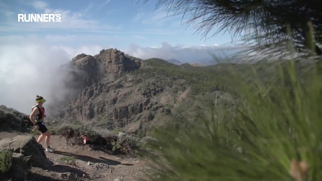

# Como un latir de pies que no se acaba

Como un latir de pies que no se acaba. Hablan con la tierra en una lengua quizá antigua, ininteligible y apenas apreciable para el resto. Pero yo sé que hablan en ese rítmico silencio en que se cuentan las historias que viven muy adentro de los corazones. Historias sobre dejar atrás lo que pertenece al polvo inerte de lo que el tiempo apartó a un lado, historias sobre sueños y acercar a sus manos lo que está tan lejos que la misma vista se cansa de sostener. Claro que conozco esas historias muy bien, como muchos otros. Pero ellos las cuentan muy diferente, las cuentan con sus pies. Laten interminablemente sobre las rocas, sobre senderos que ya nadie deparaba en mirar, sobre una arena muy seca que nunca nadie acarició antes así. No sé muy bien, la verdad, por qué sus pies se empeñan tan incansablemente en narrar sus historias a tan olvidadas y yermas laderas, ni al aire solitario que las raspa, pero creo que tales caminos, casi desdibujados por su terquedad, callan secretos que sus pies descifran, como dos que se miran muy fijamente y en silencio a los ojos. Sí, creo que ellos y el camino se miran muy fijamente el uno al otro. Ojalá pudiera conocer mejor ese misterioso fluir entre medias, y entender más de cerca cómo uno se vierte en el otro, en ese nerviosismo apresurado de lo que no quiere llegar a su fin. Lo que sí conozco con seguridad es que esos hombres y mujeres guardan después de decenas y decenas, aún un suspiro más siempre; no por ansia de acopio, si no por hondo deseo conocer cómo continúa esa historia que el paso de los milenios acumula en el suelo bajo sus pies, y porque saben que están muy cerca de atrapar ese secreto que la isla guarda para ellos. Y que es la llave de una puerta que, al fin, cierra tesoros que llevan muy adentro. Que llevan muy adentro y por kilómetros y kilómetros unos pocos y valientes aventureros, que corren la carrera TransGranCanaria estos días.  
  
Mucho ánimo a todos.  
  
Mucho ánimo a Noe.  
  
<http://www.transgrancanaria.net/>  
  
Más [aquí](http://delightfulobservaciones.blogspot.com.es/2015/09/inventa-un-hueco-y-pon-en-el-un-golpe.html), [aquí](http://delightfulobservaciones.blogspot.com.es/2013/01/transcendental-running.html) y [aquí también](http://delightfulobservaciones.blogspot.com.es/2012/11/desde-las-cumbres-del-corazon.html).    
  

