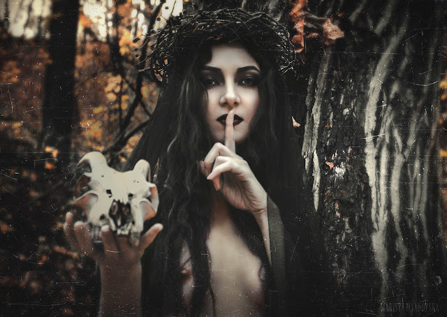

# Le llaman La Bruja

Se oculta en el bosque. Al cobijo de las suaves sombras respiran tranquilas las brisas de robles húmedos y maderas hiedradas. Algunas piedras balancean arroyos que corretean sus escalofríos médula abajo. Sendas anónimas y recobecos indistintos, al ojo no iniciado. Y, sin embargo, ocultan. Si no lo ves, quizá no lo hayas deseado aún. Si no lo buscas quizá sea de ti de quien se esconde. Escuchando más atentamente, susurrarán sus búhos, advertirán sus canes de que muy cerca se encuentra el brillo ahogado y esquivo que ella atesora, que ella protege. Porque no se oculta por temor, no; si no por preservar lo puro, por hastío de lo mediocre, por no precipitarse en el abismo de los vacíos.

Le llaman La Bruja. Algunos cuentan haberla visto incluso, pero de todos modos le llaman La Bruja. En noches sin luna, seguros al calor seco de una hoguera narran sus amores con las criaturas de la noche, sus enloquecidos cantos oscuros en lenguas que ya todos olvidaron y cómo atesora venenos que hacen a los mortales bucear los mundos de los espíritus de la tierra y del fuego, o también cómo sus delgados y largos dedos fulminaron aquella noche al más fornido de los hombres del valle en un golpe súbito de venganza, porque le llamaban La Bruja. Y los niños se la llevan esas noches sin luna, de hogueras de calor seco a sus sueños, para temerla en ellos también. Al igual que los hombres de voces graves y manos duras, para temerla ellos también.

Al soplar la mañana las cenizas tibias de los sueños de los hombres, las mujeres hunden sus manos en el pan de cada día y sacrifican una gallina. Y le llaman La Bruja, entre dientes, porque les robó una noche más las pesadillas de sus hombres y porque los lobos le siguen el rastro de su carne allá por las sendas anónimas, lejos de las paredes de las casas hundidas en el valle. Ahí abajo, en la apacible ribera del río, tapan sus pechos, esconden el rubor de su carne y entregan sus cuerpos fríos a los designios de los labradores y los pescadores, como rigen los guardianes de la fe. Pero no serán suyos. Serán sus corazones para La Bruja antes que para ellas, no importa cuánto la maldigan en sus oraciones.

Y es que no hay nada más sobrecogedor que una mujer sola, una mujer sola en el bosque. Qué puede haber, al fin, más aterrador que una mujer que no tiene miedo. Ella, La Bruja, cela los venenos y los hechizos, como quien sabe que su carne candente y su mirada empoderada son la fuente de la que mana esa arrolladora fuerza que trasciende los límites de lo tangible y lanza los deseos en órbitas entorno a su vientre. Por siglos el ardor yermo de los hombres, temeroso, servil a su ego, ha sometido bajo ellos el empuje de su complementaria contraparte. Salvo en La Bruja. Sabiduría y libertad, atracción y misterio, donde otros ven magia y hechizo, ella acaricia con su cuerpo y su alma los latidos oscuros de la tierra y del fuego, baila y canta con las criaturas y bebe de ellas la vida que le entregan. La sombras de los robles entre los rayos de la luna aúllan sus senos en redonda sincronía, los arroyos de su lengua arrullan canciones indescifrables, sus manos tocan prematuras la visión de lo inevitable aún por venir, y las estrellas en sus ojos callan destinos, invocan lo aún no poseído. No desees lo que no te corresponde, desprecia lo que creías que merecía la pena, anhela ser conducido de la mano al lugar donde el velo se descorre para desvelar los misterios desnudos. La Bruja todo eso lo puede brindar, pues ya muchos antes se lo entregaron todo.

Lo femenino, la luz vibrante y quieta de la tierra, doblegado a través de la memoria interminable del tiempo por el fuego aplastante de los hombres, no puede ser apagado por completo, pues escapa lento en rumores oscuros por los lugares descuidados, por esos rincones indistintos, al ojo no iniciado. Y se cobra, de un modo u otro, lo que es suyo como si la luna susurrara a las llamas que lo que pertenece a la luz tibia y constante suya siempre vuelve a ella. Rabiosos y llenos de ira, la queman viva una y otra vez, y amargamente le llaman La Bruja, pues saben que volverá, que nunca se ha ido, que son parte de ella. Tal como la historia sin principio ni fin del mundo, un interminable lanzar la guerra creadora de dos que jamás podrán derrotarse, pues son uno.

<https://www.youtube.com/watch?v=lTN1YbiOSmI>

<https://theestablishment.co/the-real-reason-women-love-witches-647d48517f66>

más en delightful:

[Quizá no te haya hablado nunca de ellas](http://delightfulobservaciones.blogspot.com.es/2015/08/quiza-no-te-haya-hablado-nunca-de-ellas.html)

[El Ángel de Comillas](http://delightfulobservaciones.blogspot.com.es/2013/01/el-angel-de-comillas.html)

[La Historia del Universo en una sola imagen](http://delightfulobservaciones.blogspot.com.es/2013/01/la-historia-del-universo-en-una-sola.html)

