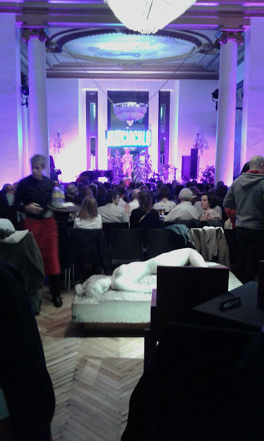

# Mensaje en una trompeta

Cuando crees haberlo atrapado, ya se ha ido. Todo sucede en diferido en nuestro mundo, un paso por detrás del real como si las cosas padeciesen un desfase, un desacople entre el flujo exterior y el que en nuestra mente se refleja como un eco a destiempo de lo que allá afuera sucedió. Sin embargo, con frecuencia astronómica, se cristaliza una sincronía que amplifica, como dos ondas que interfieren al unísono, el latir de adentro con el latir de afuera. Así un día conocí la vida de los adultos, pero ya había sucedido antes, por supuesto, de que yo lo comprendiera. Era solo que comenzaba un concierto de jazz y la trompeta me estaba hablando a mi. Y es que las trompetas no saben mentir. ¿Para qué iba a mentir el viento si de todas formas siempre huye?

Su mensaje parecía nítido, pero yo trataba de descifrarlo, torpemente, como si al principio no alcanzara a comprender que me hablaba de una nueva libertad. No de esa audaz y arrogante, sin miedo, si no de la que ya lo ha hecho suyo. Me hablaba con su voz suave de cómo la esperanza y la ilusión no se crean ni se destruyen, si no que se transforman dentro del corazón para hacer más espacio a todo lo que al final no fue y acomodar así lo acumulado. Ellas alumbran nuevas criaturas menos apasionadas, menos condenadas al fracaso, más nuestras, menos egoístas... que ya vivían en mi antes de que aquella trompeta me las señalara. Solo que me costaba ver que ya habían nacido tiempo atrás. Además, la ilusión, de lo que más celos tiene es de lo que el tiempo ha ido acumulando por los rincones, porque ella vive para tener más que para ser, como muchos otros mecanismos de supervivencia que la evolución entierra en lo hondo de nuestros instintos para hacernos avanzar, aunque sea como poco más que una epidemia. Todos ellos, han de ser conquistados para no caer en el desprecio, para que no nos ciegue el brillo enrojecido de lo lejano y olvidemos la caricia tierna de lo que ya permanece a nuestro lado. Es por eso que el hombre, si quiere ser soberano de sí mismo, ha de domesticar su ilusión y otros tantos instintos. Pero es tan difícil, me recordaba con su timbre cristalino y sobrio, por el juego sutil de esas pasiones que nos hacen creer que son nuestras y en cuanto temen que las apartemos a un lado nos susurran al oído con melancolía un "no me abandones"; pero es solo un engaño, para que no reconozcamos que más que nuestras, somos suyos. La trompeta y yo nos miramos un momento en silencio y comprendí que no debía interrumpirla aún; la continué escuchando.

De su mano, como se lleva por primera vez a un niño a acariciar a un caballo, comprendí que prender por el talle el pasado y colocarlo en su repisa es algo que se debe hacer sin miedo y con mano firme, no como si por completar un estante se vaciara el mundo. Siempre me recordará a aquella maravillosa escena del tren en que la chica, entre el humo húmedo del invierno en América, subía los tres escalones y echaba un último vistazo atrás para grabarlo en la memoria y volcar su frío en todo aquello que abandonaba, todo aquello que siempre había sido todo. Y los andenes de la estación se desolaban como si de repente los trenes se hubieran desinventado para siempre. Entonces la trompeta me cantaba sobre la excitación loca de la juventud, sobre la valentía enérgica de los años inocentes, sobre la ilusión de cuán fantástico sería tener lo que aún no se tiene; me cantaba una canción en que yo las acompañaba a su estación, y las pagaba un billete a cualquier otro lugar. "Otro las necesitará, a mi ya me amaron lo que debían amarme", más o menos cantaba su estribillo.

Yo no sabía cuánto tiempo duraría aquella música porque era jazz. Dijo un boxeador que el buen boxeo es como el jazz, que cuanto mejor es mas difícil es de apreciar. Yo estoy convencido de que se debe a la falta de un patrón, que atemoriza y ahuyenta, porque lo anterior no sirve entonces para comprender lo siguiente. Pero aquella trompeta bailaba con mi alma como un pentagrama que se deslizaba por sus vacíos raíles en blanco hacía ningún lugar. No había letra, ni voz, ni hubieran aclarado más la verdad que de ella brotaba y que me hablaba de un mundo en blanco y de cómo lo auténtico no se mide en valor, ni en mérito, ni en energía; si no en sinceridad, en desnudez, en unidad. Lo intuía desde tiempo atrás: la libertad, la ilusión y la tenacidad que laten fuerte en mi pecho, aún pretendiendo serlo todo, han sido siempre imperfectas, incompletas, insaciables, pues no dejan de ser fuerzas para amoldar el mundo a unos deseos que ni si quiera son míos, si no que viajan en mi como polizones en trenes sin destino. Amoldar el mundo, resulta muy ambicioso, pero si miro hacia adentro de mi no comprendo si quiera los caracteres de los códigos que crifran esto que yo soy. Tanto tiempo liberándome de todo lo que me ataba y, cuando creo que ya casi lo consigo, me doy cuenta de que pretendía empezar desde el lado equivocado, por fuera. Con razón reía la trompeta, mientras repetía que la sabiduría es el único camino hacia el centro, que es siempre de retorno, y que es el único lugar desde donde fabricar a penas un poco de luz, un pedazo sincero de música; mientras repetía que es lo único que merece la pena compartir, que es lo que de verdad llena el universo de instante. Y continuábamos riendo brillantes los dos mientras disolvíamos, la trompeta su viento en la música, yo mi mano en la mano de la mujer junto a mi.

Madrid, 26 de noviembre de 2017

.
