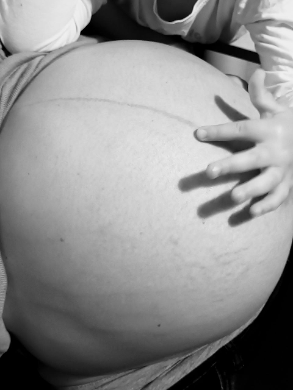

# Poco antes de Alejandra

No sabía cuánto había permanecido en aquel mar. Mi lugar no era aquel, sin duda. El agua plana, circular a través de un horizonte perfecto resultaba, por ilimitada, más parecida a una cárcel para mí. Así es para personas como yo, que pertenecemos a las montañas, a los ríos tortuosos y a los bosques de robles silenciosos y arces de colores innumerables donde los rincones, las cumbres y las formas revelan su mapa a los que llevan en sus zapatos el polvo de esos caminos.

El tiempo lleva un ritmo extraño desde entonces, pero no se empolva la visión y la certeza de aquel instante en el que, como testigo del comienzo del universo, me encontré frente a mi destino en los ojos de la mujer que amo. Resulta desconcertante navegar por un lugar así, en el que los límites se vencen justo en el momento de nacer y, por perfecto, es inmóvil, y el fondo quizás no exista. En especial para las gentes como yo, que solo comprendemos la vida como lucha contra los límites, y la fuerza tiene sentido porque hay cumbres, y las águilas son libres allá arriba, y los lobos despliegan su ingenio testarudo en lo intrincado de los bosques.

Había olvidado desde cuándo navego estas aguas para las que no conozco mapa, ni fórmula para disolver mi mente en vuestros corazones. Yo creía conocer los infiernos de este mundo, y haber vuelto a renacer en tres días, o incluso menos. Este mar me ha mostrado qué hay más abajo, cuánto horror y cuánta pena puede dormir en un vientre y lo caprichoso de su sueño; y he tenido que viajar allí de la mano de mi mujer. Sin embargo, no hay amor sin esperanza, y este querer no duerme. Y he comprendido, con sus manos en las mías, con mis fuerzas enloquecidas y mi mente tomando una bocanada de aire fresco, que la verdad no es mía y que tengo junto a mí todo lo que me falta, lo que creyendo que detestaba, había estado todo este tiempo buscando.

Siempre que creo ver, estoy en realidad dormido; cuando despierto, comprendo que solo veo la superficie. Por eso siempre estoy equivocado. Yo solo aspiraba a traer luz a este mundo, pero la luz que hay en mi resulta ser no más que un reflejo. Solo cuando me rindo en las incontestables manos del vacío, la ironía del universo me eleva al corazón de la mujer que amo. Así comprendí, hija, que te llamarías Alejandra.

Y descubrirás que Alejandra es la clave del faro, que la mayor defensa de los hombres es conservar la luz que los guía y que el más desafiante de los laberintos, el más despiadado de los mares, es el círculo indescifrable de lo que uno es, de lo que uno mismo no es, de lo que uno mismo niega ser. No hay tesoro que no sea la cara de tu moneda, y su cruz es el desafío de abrazarlo, de aceptarlo, de rendirse a él. No es casualidad que a tu irrepetible capital las musas de oriente y occidente acudieran a completar su mente y su corazón con lo que intuían como su otra mitad. Y tu tesoro, hija mía, es el conocimiento que otros trajeron a ti y la memoria de lo que te precede; y tú su guardián, el escribano que acaricia cada renglón de esta biblioteca como a sus innumerables e irrepetibles hijos.

No dudes, pequeña, que necesitamos a la verdadera defensora de los hombres, ni que en los momentos más brillantes, y también en los más oscuros, no faltará la luz que sostendrás bien alto en tu mano firme y tu corazón fiel, pues Helena está contigo: tu primera compañera, tu hermana, quien ya te conoce y admira tu resplandeciente rostro desde antes de que lo comprendamos.

No dejo de maravillarme en lo intrincado de todas estas sincronicidades, increíbles misterios que viajan adelante y atrás por estas líneas como flechas retorcidas, sorpresas que cobran sentido conforme avanza la historia, hasta el punto de sospechar que una novela minuciosamente escrita despliega su intrincado guion sobre mi mundo, solo por juguetear con ingenios a tramar mi realidad. Yo ya me creo cualquier cosa. Sobre todo creo en el fruto del amor de nosotros, tus padres, y en esto me entrego, hija. Si algo puedo ser para vosotras, que no sea vacío o que no pudiera serlo cualquier otro, es este puñado de palabras que, como un juego más, imagino que acarician tu corazón, que te hacen sonreír, y en ti pongan un soplo de aire que te dé vida.

Te quiero, Alejandra.

León, 25 de septiembre de 2023.

<https://delightfulobservaciones.blogspot.com/2019/06/poco-antes-de-helena.html>

<https://delightfulobservaciones.blogspot.com/2017/11/mensaje-en-una-trompeta.html>

<https://delightfulobservaciones.blogspot.com/2013/02/dimelo-con-tus-manos.html>

