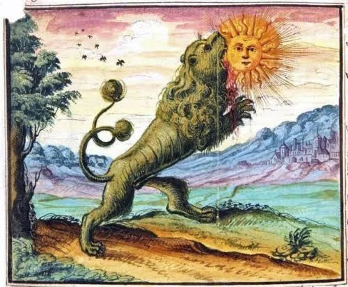

# Sol de mi corazón

Brilla sobre mi piel e inunda mis ojos. Así puedo ver cómo creas y alimentas la vida a mi alrededor. Sol de mi corazón, enciende mi amor y juntos hagamos que corra sin freno la sangre por mis venas para que tu fuerza mueva el mundo a través de mis manos. Quién soy yo si no el agente de tu calor que convierte el pasado en futuro, que observa girar la rueda de la vida. Quién soy yo si no quien acaricia tus rayos en mis dedos y desde ellos proyecto las sombras que dibujan mis deseos. Quién soy yo si no el testigo de tu vibrar, admirando como despiertas el día y mi corazón de su sueño.

En las frías noches no te olvido, ni pierdo mi fe en que volveré a tus brazos, sol de mi alma. Fácil es caer en la oscuridad y perderse en el vacío, si los sueños no son limpios. Los caminos se desdibujan para las almas ciegas, pero la fosforescencia de un amor sin descanso guía los pies de los que tampoco en las noches dudan, las manos de los artesanos de lo que no se puede tocar ni comprar, la voz de en quien la verdad no se ahoga cuando la luz es más débil. En las oscuras noches no te olvido, sol de mi corazón; y sé que has de dejarme solo para que el latir de mi vida en las profundidades de mi sueño y en el vacío de mi pecho vibre con nuestro reencuentro. Ahí ofreceré los tesoros de mi incierto viaje, los diamantes puros y raros que excave, las soledades vencidas, las dudas arrodilladas ante la luz que no se acaba. Y ahí volveré una y otra vez a ti hasta la noche en que ya nunca duerma, en la que volveremos a ser uno, sol de mis ojos.

Conozco el círculo en torno a tus rayos. He sentido la frecuencia precisa y el bailar perfecto. Casi puedo alcanzar con mis manos a leer tus órbitas como quien desentraña un mapa. En él, tus rayos descienden rectos por la gran pirámide. Yo los saludo con mi curvada sonrisa, pues me enseñan el camino que eleva las espirales de este espíritu que baila con mi corazón. Los cuadrados escalones me van explicando lo inevitable que es tu esfera. Yo no sé nada, pero en mi siempre supiste que de dos solo puede hacerse uno solo, que lo de abajo existe para ascender y lo de arriba para tender la mano a quien admira, que el destino de lo vivo es comprender que está aún dormido y despertarse a la unidad de luz de tu rostro, sol de mi corazón.

Más aqui

<https://delightfulobservaciones.blogspot.com/2012/05/desayuno-cantabrico.html>

<https://delightfulobservaciones.blogspot.com/2012/11/ley-natural-del-tamano.html>

<https://delightfulobservaciones.blogspot.com/2015/09/inventa-un-hueco-y-pon-en-el-un-golpe.html>

