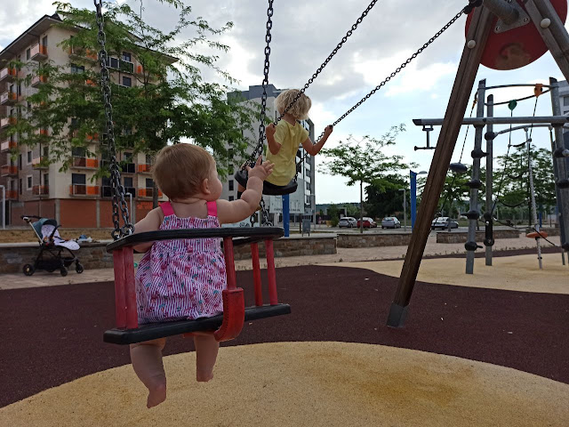

# Si es verdad como dicen los sabios

Voy atravesando la jungla de la nada, apartando a uno y otro lado malezas y flores incomprensibles. Voy atravesando estos valles, aguantando la respiración en este aire impuro de fragancias y susurros, sabiendo en el fondo de mi corazón que allá arriba las cumbres me esperan con un sabio silencio. Espero el paso del día, el término del atardecer, como un niño extendiendo los brazos hacia su madre para recostarse en el infinito regazo de la noche, en la que siempre al caer nazco a la luz no reflejada de cada estrella en su cantar sincero. Esa luz que me muestra los rostros auténticos y desnudos de los astros de mi cielo, lejos de las luces y sombras ajenas a ellos que son todas nada más que proyecciones de la mía. Estos ojos cansados de ver solo lo que pienso, como lo pienso y solo si lo pienso, me muestran mi rostro repetido allá donde miran. Pero mi alma sopla sobre estas cenizas para limpiar los objetos circundantes de mi polvo.

Ay mis limpias y auténticas estrellas! Cuánto río en vuestra inmensa risa cristalina! Cómo naufrago en vuestros ojos libres de error y ceguera! En vuestra sonrisa yo paladeo la sabiduría última que es la primera. Yo tomo vuestra mano fingiendo que os llevo seguras a mi lado, mientras sabemos que soy yo guiado a cada paso, porque cada paso que pongo a mis espaldas me aleja de lo que siempre fuimos: uno, limpio y sin límite. Cada renglón que añado a mi historia agranda la bola de nieve de las cosas que no son yo. Cada idea con que creo profundizar en lo que sois añade peso, desfigura, me aleja del respirar transparente con que bendecís mi  mundo.

Si es verdad, como dicen los sabios, que la verdad es una tierra sin caminos, nada me puede acercar a quien sois, hijas mias: solo puedo mirar maravillado lo cerca que estoy cuando me doy cuenta de que ya estamos juntos. Y en esta risa nuestra en que me dejáis nadar, en esta mirada vuestra en que volamos hacia ningún lugar porque ya hemos llegado, puedo comprender que sois vosotras mi hogar. Y si es verdad, como callan los sabios, que el universo es solo un pensamiento de Dios, porque no puede permanecer en silencio más que cuando se mira en el espejo de nuestras consciencias, que no son muchas si no una repetida; si es verdad esto, hijas mías, ahora entiendo quién realmente somos. Y en la paz y el silencio, en el caminar las líneas entre la vida y la muerte, entre la luz y la oscuridad, entre el amor y la nada, en este lugar singular que inunda el mundo al tiempo que le damos vida, aquí nace la certeza de que nada nos puede hacer daño, que nada tenemos que temer ni nos puede separar. Así entiendo que no importa que esto que llamo “yo” se disuelva en el remolino del viento al que siempre perteneció. Así me lanzo en vuestras infinitas manos para la que todo es comienzo, en vuestra mirada ligera que es toda sabiduría, en vuestra risa sin límites para la que todo es instante.

más:  
  
[El Tao de ser padre](https://delightfulobservaciones.blogspot.com/2024/03/el-tao-de-ser-padre.html)

[Poco antes de Alejandra](https://delightfulobservaciones.blogspot.com/2023/10/poco-antes-de-alejandra.html)

[Poco antes de Helena](https://delightfulobservaciones.blogspot.com/2019/06/poco-antes-de-helena.html)

